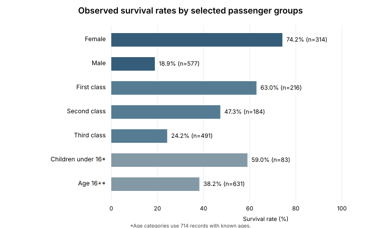
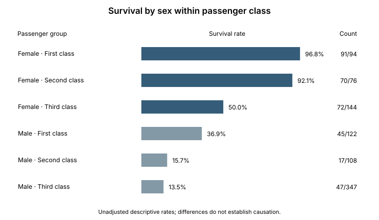

# Passenger Survival Patterns in the Titanic Dataset

**A descriptive study of sex, passenger class, age and missing information**

**Amogelang R. Pelo**

## Abstract

I investigate patterns of recorded survival in a 891-row Titanic passenger dataset using exploratory data analysis (EDA) and a source-based review of the associated Python notebook. The project examines differences in survival by passenger class, sex and age, as well as missing observations and ticket-fare distributions. I reproduced descriptive counts directly from the project CSV to distinguish measurable associations from interpretations proposed in the notebook. In the supplied records, 342 passengers are marked as survivors, corresponding to an overall observed survival rate of **38.38%**. The rate is **74.20% for females** and **18.89% for males**. By passenger class, the corresponding rates are **62.96% for first class**, **47.28% for second class** and **24.24% for third class**. Among 714 records with known age, the observed survival rate is **59.04% for those younger than 16** and **38.19% for those aged 16 or more**.

These associations are substantial but cannot establish the causal mechanism of evacuation or access to lifeboats. The dataset is a subset of Titanic passengers rather than a complete census, and age, cabin and embarkation information are missing in 177, 687 and 2 records respectively. I conclude that sex and class display strong descriptive associations with survival in the supplied sample, while careful treatment of missing information and subgroup composition is essential for defensible interpretation.

**Keywords:** Titanic; exploratory data analysis; survival; passenger class; missing data; descriptive statistics; reproducibility.

## 1. Introduction

The sinking of the RMS Titanic has become a common setting for studying survival patterns using historical passenger records. The data invite questions about demographic and social differences: whether female passengers survived more frequently, whether first-class passengers fared differently from other classes, and whether children were more likely to survive than adults. These are important statistical questions but are also vulnerable to overinterpretation, because a surviving dataset records outcomes without capturing every decision and circumstance that produced them.

The source project consists of a Python notebook and a CSV of passenger records. The notebook loads data with pandas, examines summary statistics and missing values, and creates plots of survival outcomes, passenger class, sex, age, ticket fares and selected numerical correlations. It proposes that sex is a particularly strong survival-associated variable and that higher-class passengers also had higher survival rates (Pelo, n.d.-a).

My research question is: **How do survival rates vary across sex, passenger class and age in the supplied records, and what limitations should govern the interpretation of these differences?** I approach this as an exploratory, observational study. Rather than building a prediction system, I verify proportions and inspect how the recorded variables relate to the outcome. I also consider the interaction between sex and passenger class, which is not captured adequately by simply ranking each variable in isolation.

Exploratory analysis is appropriate because it identifies structure, anomalies and potentially useful questions without pretending that the data have already supplied causal identification (Tukey, 1977). However, descriptive patterns should still be reproducible, numerically explicit and cautious about the sampling frame. The paper therefore separates the original notebook's implemented operations from additional tabulations and figures produced for this report.

## 2. Literature and analytical framework

### 2.1 Exploratory data analysis

Exploratory data analysis uses graphs and descriptive summaries to examine data before imposing an elaborate statistical model. Frequency tables, conditional proportions, numerical summaries and distribution plots help an analyst detect broad differences and assess whether certain variables are informative. Tukey (1977) emphasised the importance of examining what the data reveal rather than allowing a formal model to determine every question in advance.

For a binary outcome such as survival, the proportion of survivors within a group is more informative than the raw count alone when group sizes differ. For instance, comparing the number of surviving first-class and third-class passengers is misleading unless the total number of passengers in each class is also considered. I therefore report denominators alongside percentages, and I avoid equating the largest survivor count with the highest survival probability.

The principal quantity in this paper is the observed conditional proportion of survival among rows in a group, calculated as `group survivors / group records`. This is a property of the supplied dataset. It is not automatically an estimate of a causal effect or a population-level survival probability with an established sampling design.

### 2.2 Joint and marginal relationships

A variable may be associated with an outcome overall while the relationship differs within subgroups. Passenger class and sex, for example, have different distributions and potentially interact with access to resources and evacuation circumstances. Comparing sex-specific rates within each class can reveal whether an overall female–male difference is simply an artefact of different class composition, or whether substantial within-class differences remain.

This type of stratification is especially relevant when describing observational data. It helps prevent interpretations that overlook another variable, although stratification alone does not remove unobserved confounding (Agresti, 2013). The conclusions here remain descriptive even when the differences are large.

### 2.3 Missing data and selection

The dataset includes blank fields for age, cabin and embarkation location. Missing values do not all have the same implications. An absent cabin entry may reflect documentation or allocation practices, while an absent age may complicate an age-related analysis. Excluding all rows with any missing field could remove a large part of the sample and alter group composition.

Missing-data research distinguishes patterns such as missing completely at random, missing at random conditional on observed variables and missing not at random. Those mechanisms cannot be established merely by counting blank cells (Little and Rubin, 2019). Accordingly, I report the observed missingness and use clear denominators for age-based comparisons instead of silently discarding records.

### 2.4 Historical interpretation

The notebook asks whether the often-repeated rule of prioritising women and children is supported by the observed survival outcomes. Higher survival among females and younger passengers is consistent with such an interpretation but cannot uniquely establish that policy's implementation or its effect. A historical conclusion would require evidence about the evacuation procedures, passengers' locations, timing and behaviour that is not included in the CSV. Statistical patterns offer evidence relevant to a historical question, not a substitute for independent historical sources.

## 3. Data and methods

### 3.1 Data source and observation unit

The repository provides `Titanic.csv`, containing **891 passenger records and 12 columns**, and `titanic_original.ipynb`, which records the author's exploratory workflow. Fields include `PassengerId`, `Survived`, `Pclass`, `Name`, `Sex`, `Age`, `SibSp`, `Parch`, `Ticket`, `Fare`, `Cabin` and `Embarked` (Pelo, n.d.-a; Pelo, n.d.-b).

The variable `Survived` is coded as 1 for recorded survival and 0 otherwise. `Pclass` codes the three passenger classes. `Sex` provides the categories recorded in the dataset, which I label as female and male without treating this field as a comprehensive representation of gender identity. Age is numeric but missing for some rows.

The data resemble the widely circulated Titanic training dataset used in machine-learning exercises, but the repository does not include an independently verified primary archival provenance for its particular copy. I therefore state all results as properties of the supplied file and do not equate its 891 rows with every person aboard.

### 3.2 Data completeness

I inspected the header, record count and blank entries in each field. The main missing-value observations are as follows:

| Variable | Missing records | Share of all 891 rows | Analytical consequence |
|:--|--:|--:|:--|
| Age | 177 | 19.87% | Age comparisons cover 714 known ages |
| Cabin | 687 | 77.10% | Cabin-based interpretation would be severely incomplete |
| Embarked | 2 | 0.22% | Small missingness, but requires explicit handling |
| Survived | 0 | 0% | Outcome observed for every provided row |
| Pclass | 0 | 0% | All rows enter the class comparison |
| Sex | 0 | 0% | All rows enter the recorded-sex comparison |

The original notebook uses `info()`, `describe()` and `isnull().sum()` to identify data types and completeness. It does not create a formal imputation procedure or remove all incomplete rows before making the survival charts. In this paper, I preserve the full sample for sex and class rates and restrict the age tables to explicitly defined known-age groups.

### 3.3 Descriptive calculations

I verified the survival counts for each group directly from the CSV, computed percentages to two decimal places and compared sex–class combinations. I also examined fare summaries to assess their distribution and the relationship between fare and class. These additional calculations are distinct from the original notebook's saved visualisations; they do not imply that I estimated a multivariable causal model.

The notebook employs pandas for tabulation and seaborn/Matplotlib for count plots, histograms and a numerical correlation heatmap. Its principal findings are qualitative interpretations of those visualisations. My added numerical tables make the magnitudes traceable and permit comparison of categories with different sample sizes.

### 3.4 Analytical boundaries

No regression coefficients, confidence intervals, causal effect estimates, sensitivity analysis for missing ages or out-of-sample predictive metrics are claimed as original project outputs. The findings refer to recorded passengers in the source file. A statistically significant difference, if separately tested, would still not demonstrate why the difference occurred; the current study is descriptive and should not be presented as an experimental evaluation.

## 4. Results

### 4.1 Overall recorded survival

Of 891 records, **342 have `Survived = 1`**, and **549 have `Survived = 0`**. The resulting recorded survival rate is **38.38%**, with a non-survival rate of **61.62%**. This base rate is the reference point for interpreting each conditional group percentage.

The data also contain unequal numbers of passengers across sex and class. Raw survival totals cannot therefore be interpreted without denominators. This is particularly important for third-class passengers, who form the largest class group in the dataset but exhibit the lowest class-specific survival rate.

### 4.2 Survival by recorded sex

The dataset contains 314 females and 577 males. Of the females, 233 are recorded as survivors; of the males, 109 are recorded as survivors.

| Recorded sex | Total records | Survived | Did not survive | Survival rate |
|:--|--:|--:|--:|--:|
| Female | 314 | 233 | 81 | 74.20% |
| Male | 577 | 109 | 468 | 18.89% |
| Total | 891 | 342 | 549 | 38.38% |

The **55.31-percentage-point difference** between these conditional rates is large. In the observed sample, females are far more frequently coded as survivors than males. The notebook's qualitative conclusion that recorded sex is strongly associated with survival is therefore supported by the data, but the observed proportions alone do not identify the mechanisms behind this association.

### 4.3 Survival by passenger class

The first-class group includes 216 records, the second-class group 184, and the third-class group 491. The recorded survivor counts are 136, 87 and 119 respectively.

| Class | Total records | Survived | Did not survive | Survival rate |
|:--|--:|--:|--:|--:|
| First | 216 | 136 | 80 | 62.96% |
| Second | 184 | 87 | 97 | 47.28% |
| Third | 491 | 119 | 372 | 24.24% |

The difference between first- and third-class survival rates is approximately **38.72 percentage points**. This observation supports the notebook's statement that class is associated with survival. It does not prove that class alone caused the difference, since class may also correlate with age, sex, location on the ship, travel arrangements and other factors unmeasured in the data.

<figure class="chart wide"><figcaption>Figure 1. Descriptive survival rates for selected passenger groups in the project CSV. Rates use denominators shown beside the bars; age groups are restricted to passengers with recorded ages.</figcaption></figure>

### 4.4 Survival by age

Age is missing for 177 records, leaving 714 records with a stated age. I used a transparent **under-16** threshold as an illustrative definition of children for additional descriptive analysis. This threshold was selected for this paper and should not be mistaken for a historical legal or evacuation threshold.

| Age group | Records with known age | Survived | Did not survive | Survival rate |
|:--|--:|--:|--:|--:|
| Younger than 16 | 83 | 49 | 34 | 59.04% |
| 16 or older | 631 | 241 | 390 | 38.19% |
| Age missing | 177 | 52 | 125 | 29.38% |

Among known ages, the under-16 survival rate is **20.85 percentage points higher** than the rate for people aged 16 or more. This is compatible with the notebook's discussion of a child survival advantage. However, the 177 records without recorded ages cannot be allocated to those age groups. The differing survival rate among missing-age records also cautions against treating the known-age subset as automatically representative of the complete dataset.

### 4.5 Sex and class considered together

I additionally divided the dataset into six groups defined jointly by recorded sex and class. This reveals variation that is obscured when each factor is examined on its own.

| Sex and class | Records | Survived | Survival rate |
|:--|--:|--:|--:|
| Female, first class | 94 | 91 | 96.81% |
| Female, second class | 76 | 70 | 92.11% |
| Female, third class | 144 | 72 | 50.00% |
| Male, first class | 122 | 45 | 36.89% |
| Male, second class | 108 | 17 | 15.74% |
| Male, third class | 347 | 47 | 13.54% |

<figure class="chart wide"><figcaption>Figure 2. Recorded survival rates within each sex–class combination. Calculations are based on the supplied CSV and are presented as descriptive comparisons rather than causal estimates.</figcaption></figure>

Females have higher survival rates than males **within every class** in this sample. Class differences also remain visible within the female group: first-class females have a 96.81% observed rate, whereas third-class females have a 50.00% rate. Thus neither sex nor class by itself provides a complete description of the distribution of outcomes. The strongest purely descriptive interpretation is that the two variables jointly structure the observed differences.

### 4.6 Ticket fares and distribution

The notebook plots the fare distribution and observes substantial right skew. My direct checks find a mean recorded fare of **32.20**, a median of **14.4542**, and a maximum of **512.3292** in the source field's units. The mean exceeding the median is consistent with the upper tail visible in the notebook's histogram.

Mean fare also differs materially by passenger class: approximately **84.15** for first class, **20.66** for second class and **13.68** for third class. Fare and class are consequently not independent descriptive proxies for socioeconomic position. A statement that higher fares are associated with survival cannot, without further modelling, establish a separate effect of fare after accounting for class and other characteristics.

## 5. Discussion

### 5.1 Which variable appears most important?

The notebook identifies recorded sex as a strong indicator of survival, with class also showing substantial differences. My numerical checks are consistent with that descriptive conclusion. Female and male group rates differ by more than 55 percentage points, compared with a roughly 39-point gap between first and third classes. Nevertheless, ranking their causal or predictive importance from these two differences alone would be unsound. The groups overlap, differ in size and may involve interactions.

I would therefore state that sex shows the **largest marginal difference among the simple group contrasts presented here**, not that sex has been proved to be the uniquely most important determinant under an adjusted model. A multivariable analysis, with clearly defined outcome and explanatory variables, would be necessary before discussing adjusted associations.

### 5.2 What the data say about the 'women and children first' question

The very high recorded female survival rate and the under-16 advantage are consistent with a prioritisation narrative. Yet alternative or additional mechanisms—passenger location, availability of lifeboats, timing of access, family composition, crew instructions and records not captured in the dataset—cannot be separated using these columns. The evidence supports a pattern, not a complete historical explanation.

It is also important that age is missing for about one-fifth of records, and children can be defined using different age thresholds. I chose one reproducible threshold for illustration; changing the age cut-off would change the denominators and proportions. This provides a natural avenue for a sensitivity check in a subsequent study.

### 5.3 Social position and the limits of proxies

Class and fare both track aspects of travel arrangements, but neither is a direct observation of wealth or evacuation opportunity. A first-class ticket does not measure how quickly a person reached the deck, and a high fare does not necessarily identify the payer's net worth. I would avoid concluding that “wealth caused survival” from these descriptive records alone.

Sex–class stratification is valuable because it shows large within-class differences. It also shows variation among female passengers across class. Even this richer table does not adjust for age or cabin location and therefore remains observational. It should guide more precise questions rather than encourage sweeping explanations.

### 5.4 Missingness and data lineage

Cabin information is absent from **687 of 891 records**, meaning a cabin-level survival comparison would be driven by the minority with documented cabins unless missingness were addressed. A complete-case analysis requiring cabin and age could exclude much of the observed sample and introduce selection bias. Likewise, any claim about the survival of all Titanic passengers would require knowing how the repository's 891-row data were selected from the wider historical population.

The dataset in the repository is sufficient for reproducible classroom EDA. It is not, by itself, a substitute for archival research into passenger manifests, crew records, historical reports or vessel evacuation procedures. Clear provenance limits the scope of legitimate conclusions.

## 6. Reproducibility, improvements and limitations

### 6.1 Reproducing descriptive rates

The original notebook's pandas-based workflow can be extended to reproduce the main tables using grouped means and counts. The following code reflects the calculation logic for descriptive proportions:

```python
import pandas as pd
df = pd.read_csv("Titanic.csv")
overall_rate = df["Survived"].mean()
sex_rates = df.groupby("Sex")["Survived"].agg(["count", "sum", "mean"])
class_rates = df.groupby("Pclass")["Survived"].agg(["count", "sum", "mean"])
joint_rates = df.groupby(["Sex", "Pclass"])["Survived"].agg(
    ["count", "sum", "mean"]
)
known_age = df.dropna(subset=["Age"]).copy()
known_age["under_16"] = known_age["Age"] < 16
age_rates = known_age.groupby("under_16")["Survived"].agg(
    ["count", "sum", "mean"]
)
```

These instructions establish the reproducible summary method; they are not represented as a separate saved execution of the original student's notebook. A reader should use the repository's CSV rather than a superficially similar Titanic dataset with different row selection or cleaning.

### 6.2 Further analysis

A substantive extension would begin with careful documentation of data provenance and missingness. It could then fit an adjusted logistic regression model to examine the independent associations of sex, class and age, checking whether plausible interaction terms improve fit. Such modelling would need to make clear whether it aims at explanation or prediction and should evaluate uncertainty rather than merely quote coefficients.

Age missingness deserves specific treatment. Comparing complete-case results with transparent, defensible imputations could show how sensitive the estimated associations are to the available records. Multiple imputation may be appropriate in a more rigorous study under explicit missingness assumptions (Little and Rubin, 2019). It should not be introduced casually without assessment of its assumptions.

Finally, a historical interpretation would benefit from triangulation with primary historical sources. The dataset can reveal strong statistical disparities, but it cannot alone document the decisions made by crew and passengers during evacuation.

### 6.3 Study limitations

This paper is based on one repository CSV and the source notebook. The group percentages are **descriptive estimates for the file**, not generalised estimates for all passengers aboard or causal effects of sex, class, age or fare. The dataset's sampling mechanism and exact compilation lineage are not documented in the project. Age and cabin contain substantial missingness, and no inferential uncertainty intervals are computed here.

The sex variable uses the recorded categories supplied by the source and should not be interpreted beyond their documented scope. Additional age and joint-group tables are my extensions; the notebook's original conclusion remains a qualitative EDA interpretation. No original project forecasting model or regression study is claimed.

## 7. Conclusion

I find that survival in the supplied Titanic dataset varies considerably across recorded sex and passenger class. The overall observed survival rate is **38.38%**, but the rate is **74.20% among females versus 18.89% among males**, and **62.96% for first-class records versus 24.24% for third-class records**. The known-age subset also suggests a higher observed survival rate for passengers younger than 16. Joint sex–class tabulations demonstrate that both variables help describe differences and that a simple one-variable interpretation is incomplete.

These findings support the value of exploratory statistics for making a dataset's structure understandable. They do not establish the actual causal mechanisms of rescue, access or prioritisation during the disaster. I therefore regard the project as a useful demonstration of Python-based descriptive analysis, strengthened by explicit denominators, supplementary stratification, carefully identified missing records and transparent limits on historical interpretation.

Future research should establish the precise data lineage, test sensitivity to missing ages, study adjusted associations and combine quantitative patterns with relevant historical documentation. The strongest conclusion is that the observed group disparities are large and reproducible within this file, while their causes require evidence beyond the dataset.

## References

Agresti, A. (2013) *Categorical Data Analysis*. 3rd edn. Hoboken, NJ: Wiley.

Little, R.J.A. and Rubin, D.B. (2019) *Statistical Analysis with Missing Data*. 3rd edn. Hoboken, NJ: Wiley.

Pelo, A.R. (n.d.-a) *Titanic exploratory analysis: original Jupyter notebook*. GitHub portfolio. Available at: https://github.com/amopelo-southafrica/AI-Engineering-and-Research/blob/main/Data-Analytics/analysing-titanic-passenger-patterns/titanic_original.ipynb.

Pelo, A.R. (n.d.-b) *Titanic.csv: project dataset*. GitHub portfolio. Available at: https://github.com/amopelo-southafrica/AI-Engineering-and-Research/blob/main/Data-Analytics/analysing-titanic-passenger-patterns/Titanic.csv.

Tukey, J.W. (1977) *Exploratory Data Analysis*. Reading, MA: Addison-Wesley.
