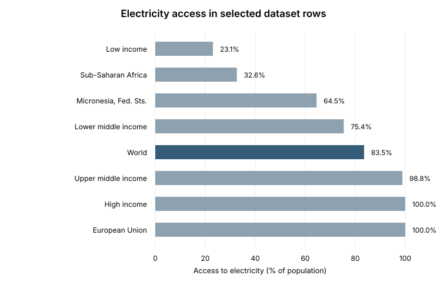
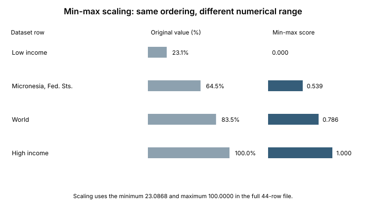

# Interpreting Electricity-Access Data After Min–Max Scaling

**A reproducible comparison of regional aggregates, income groups and normalised values**

**Amogelang R. Pelo**

## Abstract

I examine a Python project that applies min–max feature scaling to a World Bank-style electricity-access indicator and visualises the recorded values before and after transformation. The accompanying dataset contains 44 rows and 21 columns, including the variable `EG.ELC.ACCS.ZS`, which represents access to electricity as a percentage of population in World Bank metadata (World Bank, n.d.). I inspected the source notebook, checked the supplied CSV and independently reproduced the mathematical transformation. All 44 rows contain a numeric electricity-access value. The observed minimum is **23.0868%**, the maximum is **100.0000%**, the unweighted row mean is **76.6264%**, and the median is **88.9660%**. Under a default `MinMaxScaler`, the original minimum maps to zero, the maximum to one and the dataset's World row of 83.5391% maps to approximately 0.7860.

These results confirm that the transformation changes the numerical range but preserves ordering and relative linear spacing. They also reveal an important interpretive issue: the rows are predominantly overlapping income-group and geographic aggregates, with one explicitly named country, rather than a representative sample of independent countries. The unweighted mean of the rows is therefore **not a global electricity-access estimate**. I conclude that min–max scaling is useful as a technical demonstration of preprocessing, but it does not improve the underlying data quality, establish comparability of overlapping aggregates or add new substantive evidence about electrification.

**Keywords:** electricity access; min–max scaling; data preprocessing; regional aggregates; exploratory data analysis; reproducibility; World Development Indicators.

## 1. Introduction

Electricity access is frequently used as an indicator in studies of infrastructure and economic development. The relevant World Bank indicator records the proportion of the population with access to electricity and is reported in percentage terms. It is therefore suitable for descriptive comparisons, but any comparison must account for observation dates, geographic units, source methodology and differences between national records and regional or income-group aggregates (World Bank, n.d.).

The project in this paper uses the indicator code `EG.ELC.ACCS.ZS` from a file named `countries.csv`. The original notebook first drops missing values for that indicator, displays a histogram in its original percentage scale, applies scikit-learn's `MinMaxScaler` and then displays original and scaled histograms side by side. The notebook's brief written commentary discusses normalization and standardization (Pelo, n.d.-a).

My research question is: **What does min–max scaling change in the electricity-access data, and what does it leave unchanged?** I answer by reviewing the code and the actual observations, computing scale parameters and comparing selected rows. I also evaluate whether the dataset supports country-level interpretations.

The primary contribution is to distinguish a mathematical transformation from a substantive improvement in information. Scaling may be useful when a modelling algorithm combines variables with different numerical ranges. In this project, however, a **single bounded percentage variable** is rescaled to the interval from zero to one. A new numerical label does not by itself reveal a new pattern or make overlapping groups statistically independent.

## 2. Conceptual framework

### 2.1 Definition and limits of the electricity-access indicator

The World Bank describes `EG.ELC.ACCS.ZS` as the percentage of the population with access to electricity. Its methodology uses survey, census and related data sources and can include statistical estimation when direct measurements are unavailable (World Bank, n.d.). The percentage is a measure of reported access, not a complete description of the service's reliability, affordability, continuity or quality.

That conceptual limitation is relevant to the interpretation of very high values. A row showing 100% access is not proof that no household experiences outages, high prices or inadequate supply. It indicates that the recorded access measure has reached its defined maximum in that dataset.

The source file contains additional indicators such as gross domestic product per capita, renewable energy consumption, mortality and internet usage, but the notebook analyses **only electricity access**. I therefore do not infer multivariable relationships, causal effects or a predictive development model from this implementation.

### 2.2 Min–max scaling

Min–max scaling maps a variable's observed range onto a specified target interval, commonly zero to one. For an original value `x`, the default transformation is:

**x_scaled = (x − x_min) / (x_max − x_min)**, provided that `x_max` exceeds `x_min`.

A feature's original minimum maps to 0 and its maximum maps to 1. Intermediate values are placed proportionally between the endpoints. This is the method implemented by scikit-learn's `MinMaxScaler` in the project (scikit-learn developers, n.d.-a).

The transformation is affine and increasing when the observed range is positive. Consequently, it **preserves the order** of observations, the signs of pairwise differences and the relative positions of points. If two observations differ by 20 percentage points before scaling, their scaled difference is 20 divided by the observed range. The rescaled value is unitless and should not be mistaken for a new electricity-access percentage or a probability.

### 2.3 Min–max scaling versus standardisation

Min–max scaling differs from z-score standardisation. A conventional standard score is **z = (x − mean) / standard deviation**, which centres the data at zero and scales it in standard-deviation units. By contrast, min–max scaling uses observed extremes and does not centre the data.

Neither transformation automatically makes an arbitrary distribution normal. Standardisation does not remove skewness, while min–max scaling does not reduce the statistical influence of extreme observations by itself; scikit-learn explicitly notes that the latter merely rescales the feature into a bounded interval (scikit-learn developers, n.d.-a; scikit-learn developers, n.d.-b).

The distinction matters because the notebook includes a short note about the appropriateness of standardisation when study-time values are not normally distributed. **No study-time column is analysed in this particular notebook**, so that sentence cannot serve as evidence about the electricity data. This paper evaluates the actual implemented transformation rather than relying on unrelated commentary.

### 2.4 Aggregates and units of observation

A regional average, an income-group aggregate, a global total and an individual-country record are not equivalent sampling units. Several aggregates can contain the same underlying countries, so each aggregate should not be treated as an independent nation-level observation. For example, the World row encompasses other regions, while World Bank income groups and geographic classifications can overlap.

This has implications for means, distributions and inferential statistics. An unweighted mean of aggregate rows gives each aggregate equal numerical weight regardless of population size and overlap. It is not equivalent to the share of the world's population with electricity access. Recognising the unit of observation is as important as implementing scaling correctly.

## 3. Data and methods

### 3.1 Dataset and source implementation

I reviewed the six-cell project notebook and the accompanying `countries.csv` file. The code imports pandas, Matplotlib and `MinMaxScaler`, reads the CSV and executes `dropna(subset=['EG.ELC.ACCS.ZS'])`. It then plots the original indicator, fits a default scaler to that one column and appends a new `scaled_electricity` column. Finally, it plots original and transformed histograms side by side (Pelo, n.d.-a).

The inspected file contains **44 data rows and 21 columns**. The `Country` column holds three-letter codes and `Country Groups` holds names such as World, Low income, High income, Sub-Saharan Africa, European Union and Micronesia, Fed. Sts. Most named rows are geographic, income or institutional aggregates; **FSM is an explicitly named country row**. The file does not provide a documented observation-year field or data-extraction timestamp, so I do not label its values as current conditions.

| Property | Verified result | Relevance |
|:--|--:|:--|
| Rows in supplied file | 44 | Scale fitted across these observations |
| Columns | 21 | Only one indicator is scaled |
| Nonmissing electricity values | 44 | `dropna` retains all rows for this indicator |
| Lowest observed access | 23.0868% | Maps to 0 under min–max scaling |
| Highest observed access | 100.0000% | Maps to 1 under min–max scaling |
| Unweighted mean across rows | 76.6264% | Descriptive dataset mean; not a world estimate |
| Median across rows | 88.9660% | Indicates many rows near upper end |
| World row | 83.5391% | Separate recorded aggregate, not row average |

### 3.2 Replication method

I examined the column names and numerical records, counted missing electricity-access values, calculated the minimum, maximum, mean and median, and reproduced the scale equation. These descriptive calculations are additions to the notebook's plots and are clearly labelled as such.

To evaluate interpretation, I selected rows representing low-income, lower-middle-income, upper-middle-income, high-income, World, a region and one named country. The table is a **purposive illustrative comparison**, not a statistically representative sample. I preserve the original percentage values alongside the scaled scores so the reader can see precisely what information is retained.

### 3.3 Computational procedure

The core source logic can be summarised as:

```python
import pandas as pd
from sklearn.preprocessing import MinMaxScaler

countries = pd.read_csv("countries.csv")
countries = countries.dropna(subset=["EG.ELC.ACCS.ZS"]).copy()
scaler = MinMaxScaler()
countries["scaled_electricity"] = scaler.fit_transform(
    countries[["EG.ELC.ACCS.ZS"]]
)
```

This uses a single predictor column and the default feature range of `(0, 1)`. There is no training/test split because the notebook demonstrates a transformation and histogram comparison rather than a supervised model. If the scaler were later used in a predictive workflow, fitting it on all data before splitting would be a risk of data leakage; the scaler should instead be fitted on the training partition only (scikit-learn developers, n.d.-b).

### 3.4 Research limitations built into the design

I do not infer the year of the observations from the dataset's values. The World Bank metadata verifies the *meaning* of the indicator code but does not establish the provenance or currency of this particular CSV export. I do not claim that the 44 rows are independent observations or that changes in scaled values demonstrate changes over time. This is a cross-sectional comparison of values as stored in one file.

## 4. Empirical results

### 4.1 Distribution of the original electricity-access values

The 44 recorded values range from **23.0868%** to **100.0000%**. The mean of **76.6264%** is below the median of **88.9660%**, indicating that a relatively small set of low-valued aggregates pulls the mean downward. I found **eight rows below 40%**, two between 40% and 60%, eight between 60% and 80%, and 26 at or above 80%. These bins describe the dataset as recorded and do not imply that 26 of 44 countries have high access.

This distribution is concentrated toward the upper bound with a lower-valued tail. Because several categories overlap or represent aggregates, the frequency distribution should be read as a plot of **file rows**, not as a distribution across independent countries or individuals.

The minimum is the Low income aggregate at 23.0868%. At the upper boundary, Central Europe and the Baltics, the Euro area and the European Union are all recorded at 100%. These values establish the fitted scaling endpoints. They do not prove that the groups' constituent countries share identical conditions or that access quality is identical.

### 4.2 Comparison of selected entries

I computed the transformed values using the data minimum of 23.08677176 and maximum of 100. The difference between the endpoints is 76.91322824 percentage points.

| Dataset row | Access to electricity (%) | Scaled value (0–1) |
|:--|--:|--:|
| Low income | 23.0868 | 0.0000 |
| Sub-Saharan Africa | 32.6336 | 0.1241 |
| Micronesia, Fed. Sts. | 64.5315 | 0.5389 |
| Lower middle income | 75.4193 | 0.6804 |
| World | 83.5391 | 0.7860 |
| Upper middle income | 98.8438 | 0.9850 |
| High income | 99.9842 | 0.9998 |
| European Union | 100.0000 | 1.0000 |

<figure class="chart wide"><figcaption>Figure 1. Original electricity-access values for selected dataset entries. The labels mix income groups, geographical aggregates, a country and the World total; bar order is illustrative.</figcaption></figure>

The original values preserve their direct interpretation as approximate shares of a population with recorded electricity access. The scaled values provide relative positions within the *sample of 44 rows*. The World row, for example, has a recorded access value of 83.5391% but a scaled value around 0.7860. This does **not** mean world electricity access is 78.60%. It means that the World value is approximately 78.60% of the way from the dataset minimum to its maximum.

### 4.3 Effects of scaling

The transformation maps the 23.0868% minimum to zero and 100% to one. It does not change the rank of any row. If `x_a` exceeds `x_b` before transformation, it still exceeds it afterwards; ties remain ties. The same clusters or gaps visible in an original-value histogram remain present on a linearly relabelled horizontal axis, assuming comparable bin widths.

<figure class="chart wide"><figcaption>Figure 2. Four selected observations expressed in their original percentage values and as min–max scores. The score uses the full dataset's minimum and maximum rather than separate subgroup-specific limits.</figcaption></figure>

The data therefore support a narrow but valuable conclusion: min–max scaling gives a standard numerical interval, not a substantively new indicator. The transformed values may be convenient for plotting or downstream algorithms, but they cannot correct missing historical context, overlapping aggregates or possible measurement errors.

### 4.4 Why the unweighted row average is not global electrification

The file's calculated unweighted mean, 76.6264%, is below the separately recorded World value of 83.5391%. This is not a computational error. The two numbers describe different things. The first assigns each of the 44 file rows equal weight; the second is the dataset's supplied World aggregate.

Because the rows include overlapping regions and income groups, their average cannot be interpreted as a weighted average over a partition of the world's population. A defensible global estimate requires verified constituent population data and a documented aggregation method rather than averaging these file entries.

### 4.5 One country in a collection dominated by aggregates

The dataset contains the entry `FSM` labelled `Micronesia, Fed. Sts.`, with a recorded electricity-access value of 64.5315%. Its presence alongside income groups and regional aggregates is a warning about the filename `countries.csv`: the file is **not purely country-level**. If the project were extended to an analysis of national distribution or cross-country variation, rows would first need to be classified by geographic unit and aggregate entries excluded or handled separately.

This is a source-grounded data-quality issue. It is not a reason to discard the instructional value of scaling. Rather, it shows that preprocessing should begin with a careful definition of what constitutes an observation.

## 5. Discussion

### 5.1 The mathematical contribution

The notebook demonstrates a correct use of `MinMaxScaler` to convert a numeric column into a bounded feature. The code appropriately keeps the original electricity-access column, making it possible to compare the transformed variable against the original values. This is a useful programming pattern for reversible or interpretable preprocessing.

I regard the strongest lesson as one of **information preservation**. Scaling transforms a measurement's units and numerical range but does not create additional information about the countries or groups represented. A reader can reconstruct the original value from the scaled score if the fitted minimum and maximum are retained: `x = x_min + x_scaled × (x_max − x_min)`.

### 5.2 Limits of min–max scaling for bounded percentages

Electricity access is already expressed on a fixed conceptual range from 0% to 100%. Therefore the simple transformation `access_fraction = access_percent / 100` would put the indicator on a zero-to-one scale with a direct substantive interpretation: the proportion of population with access. The notebook instead applies *sample-dependent* min–max scaling, where the lowest observed group is assigned zero despite its 23.09% access value.

This distinction matters when reporting scaled scores to nontechnical audiences. A value of zero under min–max scaling does not mean there is no electricity access. It means the row has the lowest observed value in the fitted dataset. Using the resulting scores without stating their definition risks serious misinterpretation.

### 5.3 Sensitivity to dataset composition

Because min–max scaling relies on extremes, adding a row below the current minimum or above the current maximum can change every existing scaled value. Likewise, excluding the lowest-access group would alter the transformation for all remaining entries. The resulting scores should not be compared across separate datasets unless the same fitted scaler parameters are used.

A coherent extension could store `data_min_`, `data_max_` and the feature-range parameters alongside the transformed data. A versioned pipeline would help future analysts understand which sample defined the scaling. Scikit-learn's documentation cautions that the transform does not lessen the impact of outliers; it only relocates extreme values to the ends of the target range (scikit-learn developers, n.d.-a).

### 5.4 Overlapping aggregates and analytic independence

The presence of both World and subsets of World, as well as overlapping regions and income groups, means these rows cannot be treated as 44 independent countries. Independence matters if one attempts correlation, regression or confidence intervals based on row counts. Standard errors derived from an assumption of independent country observations would not be justified without restructuring the dataset.

I would begin a more substantive development study by verifying the extraction year, separating countries from aggregates, and documenting geographic coverage. Only then would I assess cross-country distributions or relationships with income, urbanisation and development measures.

### 5.5 Indicator interpretation beyond preprocessing

Even a perfectly implemented scaler cannot address conceptual limits of the electricity-access indicator. The underlying measure records access, not electricity-system reliability, affordability or sufficient service capacity. The World Bank's metadata establishes the indicator's definition but does not guarantee that every high-access entry offers comparable electricity service quality (World Bank, n.d.).

This matters particularly in policy discussions. An analysis of infrastructure performance should distinguish access from service quality and, if possible, use complementary indicators. Those additions would constitute a new research design rather than evidence already provided by this notebook.

## 6. Methodological improvements and reproducibility

### 6.1 Documentation and validation checks

The project would benefit from checks that make preprocessing assumptions explicit. I would verify that the electricity-access column is numeric, that its values lie within the expected conceptual percentage range, and that the unit labels and observation date are documented. I would also distinguish country codes from aggregate identifiers before presenting cross-national conclusions.

| Check | Recommended outcome |
|:--|:--|
| Indicator type | Numeric percentage values |
| Acceptable original range | 0 to 100 percent |
| Missingness | Record count before and after filtering |
| Observation unit | Classify country and aggregate rows |
| Scale parameters | Store observed minimum and maximum |
| Histogram comparison | Use equivalent proportional bin definitions |
| Reporting | Label scaled scores as unitless, sample-relative values |

These are **proposed validation steps**, not automated tests claimed to have been executed by the original notebook.

### 6.2 Reproduction of key statistics

The raw-to-scaled transformation can be reproduced using the supplied file and the formula shown earlier. A researcher may verify the minimum, maximum and World entry by reading the CSV and selecting the corresponding code. The arithmetic result of approximately 0.7860 for the World row follows directly from `(83.53911925 − 23.08677176)/(100 − 23.08677176)`.

When comparing original and scaled histograms, it is important to preserve equivalent binning so apparent changes do not arise from plotting defaults rather than the data. A rigorous visual comparison would use corresponding edges under the same affine transformation.

### 6.3 Limitations

This is a static review and descriptive reproduction of one educational notebook. The file contains a mixture of aggregate and national records, and its observation period is not documented. The row mean is not population-weighted. No time-series analysis, causal model, international benchmarking assessment or external validation has been performed. These limits should remain visible in any portfolio presentation.

The notebook's general comments about standardisation and other variables are not sufficient to draw conclusions about their suitability for electricity access. The research therefore centres on the transformation the code actually implements and the values the included file actually contains.

## 7. Conclusion

I find that the electricity-access project correctly demonstrates default min–max feature scaling as a mathematical operation. Across 44 supplied rows, the recorded access values range from 23.0868% to 100%, producing transformed scores from zero to one. The World row has an original value of 83.5391% and a scaled score of approximately 0.7860. The relative ordering of rows is unchanged.

The substantive contribution is a clearer interpretation of what scaling does *not* do. It does not establish current electrification levels, remove dependence among overlapping aggregate groups, improve data provenance or turn an observed dataset minimum into a meaningful zero-access baseline. I therefore regard the exercise as a useful introduction to feature preprocessing, with important lessons about observation units and communication of transformed variables.

Future work should verify the data's observation period, distinguish countries from aggregates and evaluate whether a simple percentage-to-proportion conversion would better serve the intended interpretation. The central principle is that mathematical transformations must be accompanied by an accurate account of what the original measurements represent.

## References

Pelo, A.R. (n.d.-a) *Electricity access normalisation: Jupyter notebook*. GitHub portfolio. Available at: https://github.com/amopelo-southafrica/AI-Engineering-and-Research/blob/main/Data-Analytics/comparing-electricity-access/electricity_access_normalisation.ipynb.

Pelo, A.R. (n.d.-b) *countries.csv: accompanying dataset*. GitHub portfolio. Available at: https://github.com/amopelo-southafrica/AI-Engineering-and-Research/blob/main/Data-Analytics/comparing-electricity-access/countries.csv.

scikit-learn developers (n.d.-a) *MinMaxScaler*. scikit-learn documentation. Available at: https://scikit-learn.org/stable/modules/generated/sklearn.preprocessing.MinMaxScaler.html.

scikit-learn developers (n.d.-b) *Preprocessing data*. scikit-learn user guide. Available at: https://scikit-learn.org/stable/modules/preprocessing.html.

World Bank (n.d.) *Access to electricity (% of population): Metadata for EG.ELC.ACCS.ZS*. World Development Indicators Metadata Glossary. Available at: https://databank.worldbank.org/metadataglossary/world-development-indicators/series/EG.ELC.ACCS.ZS/~/~/~/home.
