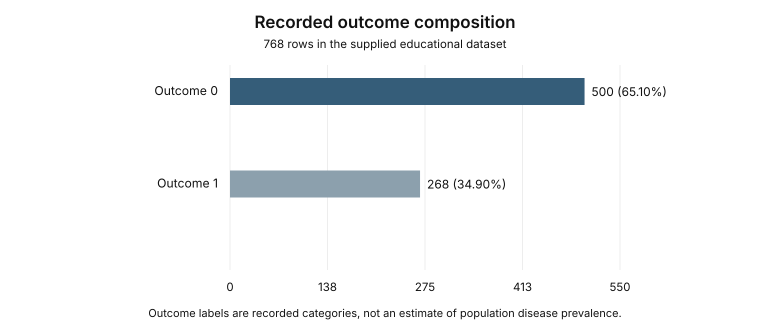
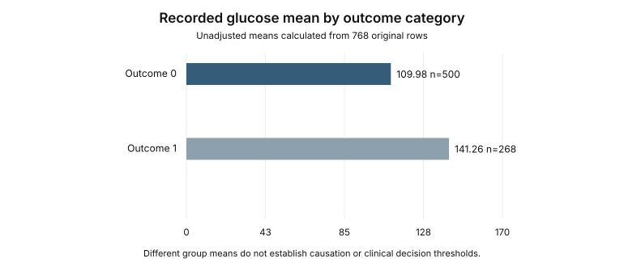
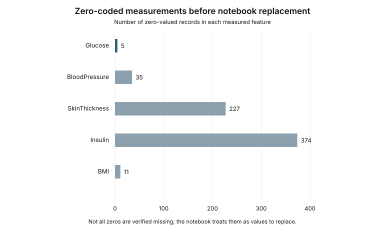

# Exploring Recorded Diabetes Outcomes with Python Visualisation

**A data-provenance and zero-value sensitivity study of an educational outcome-labelled dataset**

**Amogelang R. Pelo**

## Abstract

I review an exploratory Python notebook that compares glucose, body-mass index (BMI), age and other recorded measurements with a binary diabetes outcome label. A source audit revealed that the notebook originally expected a file named `diabetes(1).csv` with an `Outcome` column, while the portfolio folder contained an incompatible 442-row diabetes-progression dataset. I located the appropriate **768-row, nine-column** outcome-labelled file in another assignment in the original HyperionDev repository and restored it without modifying its contents. The source Git blob SHA is `db6f317685a4668bc0529b16ea1544022e780002`.

Of the 768 observations, **268 have Outcome = 1** and **500 have Outcome = 0**, corresponding to **34.90%** and **65.10%** of the file, respectively. On raw recorded values, mean glucose is approximately **141.26** in the positive-outcome group and **109.98** in the other group; corresponding means for BMI are **35.14** and **30.30**, and for age **37.07** and **31.19**. However, zero-coded measurements pose a substantial preprocessing problem. There are **374 zeros in Insulin** and **227 in SkinThickness**. The original notebook replaces zeros using each column's median *including the zeros*, yielding an insulin replacement of **30.5**. Excluding zero entries from the median calculation instead yields **125**, a materially different value.

I preserved the original notebook and created a separately labelled corrected copy. The updated analysis makes zero handling explicit, uses nonzero-entry medians and changes an erroneous final code cell into a limitations-focused markdown discussion. I conclude that the notebook is useful evidence of exploratory data-analysis skills, but its observations cannot establish statistical significance, causal effects, clinical prediction quality or general-population disease prevalence.

**Keywords:** exploratory data analysis; missing data; zero-coded measurements; Python; pandas; glucose; data provenance; correlation; reproducibility.

## 1. Introduction

Exploratory data analysis is the process of examining measurements through summary statistics and visual representations before assigning a strong model or interpretation. Histograms reveal distributional features, boxplots highlight differences in centre and spread, scatterplots show relationships between measurements, and correlation matrices summarise pairwise linear associations (Tukey, 1977). These methods are important, but they do not automatically establish why observed differences occur.

The project examined here is a HyperionDev notebook that loads a diabetes dataset, inspects its structure, replaces zeros in selected measurement columns and plots the outcome distribution, age distribution, glucose and BMI by outcome, a correlation heatmap and glucose against age. The final cell offers qualitative interpretations about glucose, BMI, age and the recorded outcome (Pelo, n.d.-a).

The notebook raises an important methodological question: **How reliable are descriptive visualisations when the data source and zero-value replacement procedure are not fully documented?** A plot can be rendered successfully even when it uses an inappropriate dataset or a questionable imputation rule. Furthermore, an observed difference between people labelled Outcome 0 and Outcome 1 need not identify causal effects or support individual medical decisions.

I therefore examine the notebook in two stages. First, I verify that the source file matches the variables and observations expected by the code. Second, I independently reproduce the main descriptive counts, means and correlations and assess the impact of zero handling. I distinguish the original submission from corrections made for the research portfolio.

The analysis is a statistical-learning exercise, not clinical research with documented recruitment, consent, diagnostics or prospective testing. The dataset does not provide the full information needed to infer population prevalence or treatment effects.

## 2. Statistical and methodological framework

### 2.1 Descriptive statistics and outcome groups

A binary outcome is commonly represented by zero and one. In the present data, the notebook labels Outcome 0 as no diabetes and Outcome 1 as diabetes. These codes are taken as the recorded categories supplied in the file. Their frequency establishes the composition of the dataset, not the occurrence of disease in an outside population.

Conditional means compare numerical variables within each category. If the average recorded glucose among Outcome 1 rows exceeds that among Outcome 0 rows, the analyst may state that a descriptive difference exists in this file. That statement does not establish whether glucose independently causes the outcome, whether measurement timing is comparable or whether the difference would appear in a representative population.

A reliable analysis reports denominators and preserves distinctions between raw descriptive variables, imputed values and results from fitted models. The notebook contains exploratory plots but no regression analysis or statistical hypothesis test. Consequently I use words such as **association** and **difference**, not **effect** or **statistically significant**, when describing its empirical results.

### 2.2 Correlation and its limits

The Pearson correlation coefficient quantifies the linear relationship between two numerical variables. It ranges from minus one to plus one and is not a percentage of explained disease cases. When one of the variables is binary, Pearson's correlation can summarise an association between a measurement and the outcome label, but interpretation still depends on the distribution and the data-generating process (Agresti, 2013).

A correlation heatmap can identify which features have the largest absolute unadjusted correlations. It cannot prove causal importance, adjusted predictive value or independence from other recorded measurements. For example, age, BMI and glucose may have relationships with one another; a univariable correlation does not hold the others constant.

The original notebook's final prose refers to higher glucose levels as significantly related to the outcome. Because no hypothesis test, p-value or confidence interval appears in the inspected notebook, the word **significant** is not supported as a statistical conclusion. In the corrected version, the wording is changed to unadjusted descriptive association.

### 2.3 Zero-coded measurements and missingness

A numerical zero can be a genuine measurement or an implicit missing-value code. Distinguishing the two requires variable definitions and a source data dictionary. If zeros are treated as missing and replaced by a single summary value, the analyst makes an assumption that should be stated and tested for sensitivity (Little and Rubin, 2019).

Median imputation is a simple technique: missing entries receive the median of observed entries in a field. However, if the placeholder values are included when computing the median, the replacement may be distorted. This matters most when a large share of the column consists of the placeholder. The raw `Insulin` field in this dataset has 374 zeros among 768 rows, making zero treatment a central data-quality question rather than a minor cleanup detail.

Single imputation also changes the variance and distribution of a measurement. A large number of equal imputed values can create a spike in a histogram, change correlations and understate uncertainty. More sophisticated missing-data methods may be appropriate for formal inference, but require assumptions and validation beyond this educational exercise (Little and Rubin, 2019).

### 2.4 Reproducibility and data lineage

Data provenance records where a file came from, its variables and how it was transformed. If the wrong dataset is placed beside a notebook, the script may fail immediately or, more dangerously, produce results with unintended meanings. Preserving the original inputs and documenting replacements are necessary parts of analytical reproducibility (Peng, 2011).

The corrected portfolio version retains the original notebook as a separate file and identifies the precise restored dataset. It also distinguishes the unrelated diabetes-progression file, which has 442 records and a different target variable, `Progression`.

## 3. Data sources and analytic procedure

### 3.1 Original notebook and initial mismatch

The original notebook includes twelve cells. Its first cells import pandas, Matplotlib and seaborn, then execute:

```python
df = pd.read_csv("diabetes(1).csv")
```

Later code refers explicitly to `Outcome`, `Glucose`, `BloodPressure`, `SkinThickness`, `Insulin`, `BMI` and `Age`. The source folder initially contained a file called `diabetes.csv` with **442 records**, columns `age`, `sex`, `bmi`, `bp`, `s1`–`s6`, and a `Progression` outcome. That is a different kind of regression dataset, not a compatible input for the visualisation code.

The absence of the requested filename and the incompatible schema would prevent the original notebook from producing the intended outcome plots. I did not relabel the 442-row file or manufacture an `Outcome` column for it.

### 3.2 Recovery of the correct input

A search of the original HyperionDev source located a different `diabetes.csv` under the M10T03 Random Forests code materials. That file contains **768 rows** with the nine columns required by the visualisation notebook: `Pregnancies`, `Glucose`, `BloodPressure`, `SkinThickness`, `Insulin`, `BMI`, `DiabetesPedigreeFunction`, `Age` and `Outcome`.

I copied this file to the visualisation folder as `diabetes(1).csv` and verified that the Git blob SHA matches the original source. The same correction was made in the Mathematics and Statistics portfolio's copy of the visualisation project. The 442-row file is preserved separately under its original name so that source lineage is not lost.

This is a **provenance repair across two course tasks**, not proof that the original visualisation author intended this exact version of the dataset. The matching column names and expected outcome fields make it an appropriate and explicitly sourced reconstruction. It should not be represented as an independently verified clinical data extract.

### 3.3 Verified dataset dimensions

The restored CSV has 768 observations and nine numeric columns. All rows contain an `Outcome` label of zero or one. The available file does not document observation dates, participant selection or the exact diagnostic procedure used to generate the labels.

| Property | Observed value | Interpretation |
|:--|--:|:--|
| Total rows | 768 | File records |
| Numeric columns | 9 | Eight measurements/features and one outcome |
| Outcome 0 | 500 | 65.10% of file |
| Outcome 1 | 268 | 34.90% of file |
| Mean age | 33.24 | Recorded age in years, if source units are as intended |
| Age range | 21 to 81 | Observed bounds |
| Mean glucose, raw | 120.89 | Dataset measurement scale |
| Mean BMI, raw | 31.99 | Includes zero-coded entries |

The proportion labelled Outcome 1 should not be called the diabetes prevalence of a particular country, age group or ethnic population. The sample design and inclusion rules have not been established by this repository.

### 3.4 Analytical reproduction

I directly tabulated outcome counts, zero-value frequencies, raw subgroup means, medians and Pearson correlations from the restored CSV. I also simulated two transparent imputation choices: the original notebook's median that includes zeros, and the corrected notebook's median calculated only from nonzero observations.

I did **not** fit a classification model, estimate clinical risk, calculate p-values, test predictive accuracy or infer causality. The original notebook contains plotting code and a qualitative conclusion; its saved execution cells do not establish any quantitative model results.

## 4. Results: outcome composition and descriptive differences

### 4.1 Outcome distribution

Among the 768 records, 500 have Outcome 0 and 268 have Outcome 1. Their shares are approximately **65.10%** and **34.90%**, respectively.

<figure class="chart wide"><figcaption>Figure 1. Frequency of the two recorded outcome labels in the restored 768-row source dataset. These are sample frequencies, not population prevalence estimates.</figcaption></figure>

The larger Outcome 0 group indicates unequal class sizes. This matters if the analysis is subsequently used for machine learning: a classifier that always predicts the more common outcome could appear reasonably accurate while identifying none of the positive records. That is a general methodological consideration, not a model-performance result from this notebook.

### 4.2 Raw glucose by outcome

The mean raw `Glucose` value is approximately **109.98** among Outcome 0 records and **141.26** among Outcome 1 records, a difference of **31.28** in the supplied measurement units.

<figure class="chart wide"><figcaption>Figure 2. Raw glucose means by outcome category, independently calculated from the CSV before replacing zero-coded entries. Differences are unadjusted.</figcaption></figure>

The raw glucose–outcome Pearson correlation is approximately **+0.4666**, indicating a positive association. The correlation becomes approximately **+0.4928** after the zero-coded glucose values are replaced by the median under the notebook's approach.

This example demonstrates that even a relatively small number of zero entries—five in this column—can change a numerical summary. The change does not make the new correlation more causally interpretable or clinically useful. A researcher should investigate why zeros occur before deciding on replacement.

### 4.3 Raw BMI and age patterns

The mean BMI is approximately **30.30** for Outcome 0 records and **35.14** for Outcome 1 records. The raw BMI–outcome correlation is approximately **+0.2927**. Under replacement of the eleven zero-coded BMI values with a nonzero-entry median, the correlation is approximately **+0.3120**.

The mean recorded age is approximately **31.19** in the Outcome 0 group and **37.07** in the Outcome 1 group. Age has a raw correlation of approximately **+0.2384** with the outcome label. Unlike the five measurement columns treated for zero replacement, age is not modified by the notebook's imputation step.

These results support the narrow statement that recorded BMI and age differ descriptively across the two outcome categories in this file. They do not establish that a particular BMI or age threshold predicts an individual outcome. They also do not adjust for associations among variables or for unrecorded characteristics.

### 4.4 Correlation rankings are not predictive rankings

Glucose has a stronger absolute raw correlation with the outcome than BMI or age in these records. This corresponds with the original notebook's qualitative attention to glucose as a prominent variable. However, a correlation ranking does not prove that glucose would have the strongest independent predictive contribution after other variables are included.

A rigorous predictive study would require a clearly defined target, a training/evaluation partition, fit-only-on-training preprocessing and appropriate performance metrics. None of those steps appears in the original visualisation notebook. I therefore do not call its heatmap a trained prediction system or assign model accuracy to it.

## 5. Results: zero-value quality audit

### 5.1 Magnitude of the problem

The original code identifies five columns for replacement of zero values. My direct counts are:

| Column | Zero entries | Share of rows | Median including zeros | Median excluding zeros |
|:--|--:|--:|--:|--:|
| Glucose | 5 | 0.65% | 117 | 117 |
| BloodPressure | 35 | 4.56% | 72 | 72 |
| SkinThickness | 227 | 29.56% | 23 | 29 |
| Insulin | 374 | 48.70% | 30.5 | 125 |
| BMI | 11 | 1.43% | 32.0 | 32.3 |

<figure class="chart wide"><figcaption>Figure 3. Count of zeros in the five fields selected for replacement. Zero counts are verifiable, but the dataset alone does not prove the missingness mechanism.</figcaption></figure>

The scale of missing-like values differs considerably. Fewer than one percent of glucose entries are zero, while almost half the insulin entries are zero. Treating both features with the same simple imputation rule conceals this difference.

The zero counts are facts about the source file. Whether each individual zero represents a missing measurement, an actual observation or a data-entry convention requires source documentation not supplied in the project.

### 5.2 Why the original insulin median is problematic

The original notebook executes a loop equivalent to:

```python
for col in columns_to_fix:
    df[col] = df[col].replace(0, df[col].median())
```

Because the median is calculated before replacing zeros, it includes all zero entries in the original column. In the insulin field, there are 374 zeros. This drives the original median down to **30.5**. Among the 394 nonzero insulin values, the median is **125**.

The difference is large. Replacing missing-like entries with 30.5 embeds one assumption; replacing them with 125 embeds a very different assumption. Neither choice is automatically correct, but the first does not actually use the median of the *observed nonzero measurements* when zeros are being treated as missing.

### 5.3 Corrected educational treatment

The supplementary corrected notebook uses the following structure:

```python
import numpy as np

columns_to_fix = [
    "Glucose", "BloodPressure", "SkinThickness", "Insulin", "BMI"
]
zero_counts = (df[columns_to_fix] == 0).sum()

for col in columns_to_fix:
    measured = df[col].replace(0, np.nan)
    df[col] = measured.fillna(measured.median())
```

This makes the transformation more internally consistent: values treated as missing are excluded before the replacement median is calculated. The original notebook remains preserved, so readers can compare implementations.

This is a **simple data-cleaning correction**, not a claim that median imputation is clinically validated. Nearly half the insulin observations are affected, so an analysis making substantive claims about insulin would require a careful missing-data sensitivity analysis.

### 5.4 How preprocessing changes correlations

The raw correlation between Insulin and Outcome is approximately **+0.1305**. After the original notebook's including-zero median replacement, it is approximately **+0.1485**. With the corrected nonzero-entry median approach, it is approximately **+0.2038**.

These are three different descriptions of altered versions of the same file. The coefficient changes despite there being no new outcome observations or clinical information. The example shows why a data-cleaning rule is part of the statistical specification and should be documented alongside every reported correlation.

For BMI, the corresponding raw and corrected-imputation correlations are approximately **+0.2927** and **+0.3120**. For age, which is not modified, the correlation remains approximately **+0.2384**. These comparisons illustrate variable-specific sensitivity to the treatment of zeros.

## 6. Code reproducibility and project correction

### 6.1 The incompatible file was a material reproducibility problem

The initial folder's `diabetes.csv` is a legitimate, separately useful 442-row progression dataset. It is not an appropriate input for the outcome-labelled notebook, because the latter requires columns absent from that file. Merely changing filenames without examining schemas would have risked silent confusion or an immediate code failure.

I retained that earlier file and added the appropriate 768-row dataset under the name actually expected by the notebook. I verified the Git object SHA against the source repository's corresponding file. The README in each portfolio now documents both files and distinguishes their purposes.

### 6.2 The original findings cell was not executable Python

The final cell of the original notebook was labelled as a **code cell** but contained free-standing narrative text beginning with `Findings`. Such text is not valid Python in the form supplied and would prevent sequential execution through the entire notebook.

The corrected portfolio copy converts that final cell to markdown and rewrites its conclusions using descriptive language. In particular, it removes an unsupported claim of statistical significance and avoids describing raw correlations as verified predictive performance.

### 6.3 Separation of submission and repair

The original notebook, its original illustrative plots and the source coursework report remain available for comparison. The new `diabetes_visualisation_corrected.ipynb` is explicitly a supplementary repair, not a claim that the initial student submission already contained those improvements.

This distinction is academically important. A portfolio should demonstrate the author's historical project and later growth without concealing its original limitations or falsely attributing new analysis to older work.

### 6.4 Proposed reproducibility checks

A fully reproducible future version should log the input file's SHA, verify its 768-by-9 shape, confirm the required columns, report zero counts before processing, and save the imputation policy used for each variable. It should also identify the source of the outcome label, the population frame and whether observations represent a particular period.

A modelling extension would need data partitioning before learned preprocessing, explicit evaluation metrics and an appropriate validation protocol. None of those are claimed as completed in this visualisation task.

## 7. Critical discussion

### 7.1 What the source findings do and do not show

The original notebook's plots are suitable for detecting visible differences in distributions, correlations and group averages. The recovered dataset supports several of its broad descriptive observations: glucose, BMI and age are higher on average among records labelled Outcome 1.

But descriptive association must not be restated as a causal claim. The file alone does not document why these patterns occur, whether the variables were measured before or after a relevant diagnosis or how observations were selected. A cross-sectional outcome dataset can be useful for learning statistics without answering those questions.

### 7.2 Missingness can distort apparent certainty

A single-value replacement makes a dataset appear complete but does not recover the actual missing measurements. The insulin example is particularly serious because almost half the entries are zero. Treating them all as the same imputed value compresses the observed spread and creates a large artificial concentration.

A more rigorous analysis could compare complete-record results, nonzero median imputation, a justified multivariable imputation strategy and sensitivity bounds. The assumptions underlying each approach should be stated, and their effects on correlations and group means reported (Little and Rubin, 2019).

### 7.3 Representativeness and responsible interpretation

The source CSV contains no complete record of recruitment, demographic eligibility, sample weights, clinical adjudication or observation dates. It is therefore inappropriate to generalise the file's 34.90% Outcome 1 share to all adults, all people in South Africa or any other population not established by the source.

Likewise, the plots do not identify an individual patient's status. A clinical decision would require validated measurements, appropriate professional oversight and evidence beyond exploratory group summaries. This paper's purpose is computational and methodological.

### 7.4 A general data-engineering lesson

The most useful lesson from this case is that data lineage and preprocessing are part of analytical quality. Two visually similar files named `diabetes.csv` can contain entirely different targets. A notebook may produce a persuasive plot while using an unexamined imputation rule, and a code cell containing prose can make sequential execution fail.

The project is stronger when those limitations are recorded and repaired transparently. Properly separating source artefacts from corrected copies permits readers to assess both the learning process and the reliability of the current portfolio.

## 8. Limitations and conclusion

### 8.1 Limitations

The present study is a source-based review with independently computed descriptive checks. The restored input is a 768-row educational dataset found elsewhere in the user's original HyperionDev repository; the exact original collection method and sampling frame are not verified here.

The zero treatment is an explicit assumption, not a validated missingness model. I did not fit a classifier, estimate disease risk, perform a significance test or assess causal relationships. The report therefore cannot establish predictive value, clinical utility or broader epidemiological prevalence.

### 8.2 Conclusion

I find that the notebook demonstrates a useful sequence of exploratory steps: data inspection, distribution plotting, group comparisons, correlation visualisation and scatterplot interpretation. The recovered matching file contains 768 observations, including 268 positive outcome labels. Glucose, BMI and age show higher raw group averages among records labelled Outcome 1, but those are unadjusted descriptive associations.

The greatest methodological risks concern **data provenance** and **zero-coded measurements**. The originally uploaded 442-row progression dataset could not support the notebook's outcome plots. After restoring the correct file, the insulin column revealed that 374 zeros could change an imputation median from 30.5 to 125, with a corresponding change in its apparent correlation with outcome.

I therefore present this project as evidence of exploratory Python visualisation strengthened by a transparent source audit and a separately labelled correction. Its value is methodological: it illustrates how data definitions, missing-value assumptions and reproducible code determine what conclusions an analyst can legitimately draw.

## References

Agresti, A. (2013) *Categorical Data Analysis*. 3rd edn. Hoboken, NJ: Wiley.

James, G., Witten, D., Hastie, T. and Tibshirani, R. (2021) *An Introduction to Statistical Learning: With Applications in R*. 2nd edn. New York: Springer.

Little, R.J.A. and Rubin, D.B. (2019) *Statistical Analysis with Missing Data*. 3rd edn. Hoboken, NJ: Wiley.

pandas development team (n.d.) *pandas.DataFrame.fillna and missing data*. Available at: https://pandas.pydata.org/docs/user_guide/missing_data.html.

Pelo, A.R. (n.d.-a) *Diabetes data visualisation: original Jupyter notebook*. GitHub portfolio. Available at: https://github.com/amopelo-southafrica/AI-Engineering-and-Research/blob/main/Data-Analytics/visualising-diabetes-patterns/diabetes_visualisation_original.ipynb.

Pelo, A.R. (n.d.-b) *Diabetes data visualisation: corrected portfolio notebook*. GitHub portfolio. Available at: https://github.com/amopelo-southafrica/AI-Engineering-and-Research/blob/main/Data-Analytics/visualising-diabetes-patterns/diabetes_visualisation_corrected.ipynb.

Pelo, A.R. (n.d.-c) *diabetes(1).csv: recovered educational outcome dataset*. GitHub portfolio. Available at: https://github.com/amopelo-southafrica/AI-Engineering-and-Research/blob/main/Data-Analytics/visualising-diabetes-patterns/diabetes(1).csv.

Peng, R.D. (2011) ‘Reproducible research in computational science’, *Science*, 334(6060), pp. 1226–1227.

Tukey, J.W. (1977) *Exploratory Data Analysis*. Reading, MA: Addison-Wesley.
