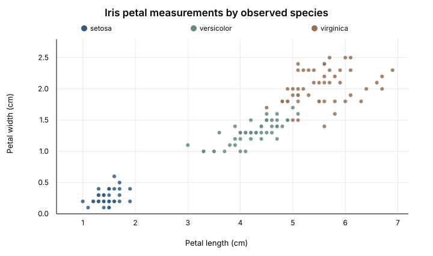
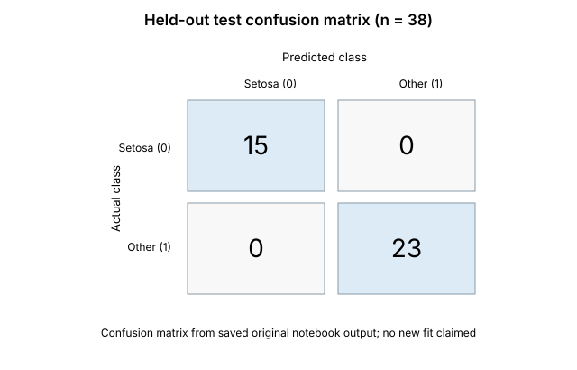

# Binary Classification of Iris Flowers Using Logistic Regression

**An evaluation of Setosa separation and held-out model performance**

**Amogelang R. Pelo**

## Abstract

In this paper, I evaluate a binary logistic regression project developed to distinguish *Iris setosa* from two other Iris species using four botanical measurements. The project repository contains a dataset of 150 observations, the submitted classification notebook and an original notebook with saved model outputs. I examined both the implemented method and the accompanying data, separating observations visible in the original notebook from additional descriptive calculations performed for this paper. The model recodes Setosa as 0 and non-Setosa as 1, reserves 25% of the data for testing and trains a scikit-learn logistic regression classifier. Its saved original test confusion matrix is **[[15, 0], [0, 23]]**, corresponding to **38 correct classifications out of 38**.

A perfect result on one split should not be interpreted as a guarantee of performance on new samples. The dataset itself displays considerable species separation: Setosa petal length ranges from 1.0 to 1.9 cm, while non-Setosa petal lengths begin at 3.0 cm. The paper discusses the consequences of this readily separable classification task, the interpretation of positive and negative labels, the limits of a small holdout sample and improvements required for reproducible predictive evaluation.

**Keywords:** logistic regression; supervised learning; Iris dataset; binary classification; confusion matrix; reproducibility; generalisation.

## 1. Introduction

Classification is a common machine-learning task in which a model learns a rule for assigning observations to predefined categories. In the Iris dataset, measurements of sepals and petals can be used to distinguish botanical species. The Iris problem has a long history as an example of statistical discrimination and multivariate analysis (Fisher, 1936). Its limited size and interpretable features make it suitable for learning the mechanics of supervised classification.

The original project simplifies the three-species problem into a binary question: can a model distinguish Setosa from flowers belonging to either of the other two labelled species? Instead of seeking separate predictions for Versicolor and Virginica, the notebook encodes both as a combined class. I examine this particular implementation rather than substituting a different multiclass exercise. The central research question is: **What does the reported perfect held-out accuracy demonstrate about the fitted logistic regression model, and which conclusions remain unsupported?**

The distinction between an observed evaluation result and a general claim is central to this study. A confusion matrix showing no errors is informative about the evaluated records. It does not establish error-free operation for all future flowers, different measurement procedures or a changed population. Further, an easily separable teaching dataset may make a classifier appear stronger than it would on a less structured task. These questions are relevant whenever educational model scores are presented as evidence of predictive reliability (James *et al.*, 2021).

My contribution is a traceable assessment of the submitted implementation. I verify the number and distribution of records in the supplied CSV, inspect the source code and saved outputs, prepare additional descriptive summaries and identify methodological decisions that shape interpretation. I do not represent exploratory additions as tests that were run in the original notebook.

## 2. Literature review and analytical framework

### 2.1 Logistic regression as a classification method

Logistic regression models the conditional probability of a binary outcome through the logistic transformation of a linear predictor. For a feature vector `x`, the model expresses the probability of the positive class as `P(y=1|x) = 1 / (1 + exp(-(β0 + β'x)))`. The coefficients influence the log-odds of class membership. Classification usually follows by comparing an estimated probability with a decision threshold, often 0.5 (James *et al.*, 2021).

A key advantage is interpretability: the learned decision boundary can be examined in relation to measured features. The algorithm nevertheless depends on its data representation, fitted coefficients, objective function and regularisation settings. The scikit-learn implementation supplies parameter defaults that may evolve across software versions, so reproducing the original result requires not only the input data but also the modelling configuration (Pedregosa *et al.*, 2011; scikit-learn developers, n.d.-a).

This project trains on four numeric features: sepal length, sepal width, petal length and petal width. It does not use the row identifier `Id` to predict the outcome. That distinction matters, because arbitrary identifiers can introduce patterns unrelated to the underlying measurement question.

### 2.2 Binary label design

The source notebook converts each label according to the rule `0 if Species == "Iris-setosa" else 1`. Hence class **0 denotes Setosa**, while class **1 denotes the combined non-Setosa group**. In many binary classification reports, class 1 is treated as the positive class by default. The notebook, however, manually names the upper-left confusion-matrix cell as `TP`, effectively taking class 0 as its positive target.

Neither interpretation is inherently invalid; a researcher may focus on detecting Setosa or on detecting the alternative class. The problem is that the intended positive class must be stated clearly before precision and recall are interpreted. The convention in scikit-learn confusion matrices is that rows represent true labels and columns represent predicted labels, ordered by the labels given or, by default, in sorted order (scikit-learn developers, n.d.-b).

### 2.3 Holdout evaluation

A train/test split separates observations used for model fitting from those used for initial evaluation. The notebook uses `test_size=0.25` and `random_state=42`, with no explicit stratification. This creates a fixed random partition for the tested configuration. Fitting and evaluation on separate records is more meaningful than calculating accuracy only on the training observations (James *et al.*, 2021).

Accuracy is the fraction of correct predictions. Precision and recall depend on which class is designated positive. A confusion matrix retains more information than accuracy alone by showing false positives and false negatives separately. When all four cells are interpreted correctly, it can reveal whether high overall accuracy conceals poor detection of a less common outcome. Here the task is unusually straightforward, so I pay particular attention to whether the result is corroborated by feature separation.

## 3. Dataset and research design

### 3.1 Dataset description and provenance

The project CSV contains **150 flower records** and six columns: `Id`, `SepalLengthCm`, `SepalWidthCm`, `PetalLengthCm`, `PetalWidthCm` and `Species`. There are 50 labelled samples for each of `Iris-setosa`, `Iris-versicolor` and `Iris-virginica`. The four measurement columns use centimetre-labelled names and contain numeric values. The separate `Id` column is excluded from the predictive model (Dataset accompanying Pelo, n.d.).

| Dataset characteristic | Observed result | Relevance |
|:--|--:|:--|
| Total labelled observations | 150 | Entire supplied dataset |
| Iris-setosa | 50 | Encoded as class 0 |
| Iris-versicolor | 50 | Encoded as class 1 |
| Iris-virginica | 50 | Encoded as class 1 |
| Predictive measurements | 4 | Sepal length/width and petal length/width |
| Train/test division | 112 / 38 | Defined by notebook's 25% holdout |
| `Id` used for prediction | No | Identifier excluded from features |

The repository data resemble the well-known Iris benchmark, originally associated with Fisher's study and maintained in the UCI Machine Learning Repository (UCI Machine Learning Repository, n.d.). However, I have not established the precise upload or version lineage of the repository's copy against every public variant. This matters because different widely circulated Iris releases contain small corrections to individual entries (scikit-learn developers, n.d.-c). Reported statistics therefore refer to **the CSV in this project folder**.

### 3.2 Implementation reviewed

The notebook imports pandas, NumPy, scikit-learn's `train_test_split`, `LogisticRegression` and `confusion_matrix`. It loads `Iris.csv`, constructs `X` from the four flower measurements and recodes `Species` into a binary `y`. It then uses the 75:25 training/test division, fits the classifier on `X_train, y_train`, predicts `X_test` and prints the resulting confusion matrix (Pelo, n.d.).

This sequence correctly places the random split before fitting the model. No feature scaling is applied in the notebook. The model is created using default logistic regression settings, without an explicitly documented solver, penalty or `max_iter`. These details should be pinned in a more formal computational record, since package defaults and convergence behaviour may vary across environments.

### 3.3 Review procedure

I first inspected the current implementation notebook and the preserved original notebook with output cells. I then counted the species records and calculated simple feature summaries directly from the CSV. These descriptive additions are not claims that I refitted the classifier with new experimental settings. The classification results discussed below are the **saved results of the original notebook**.

To keep the analysis auditable, I use the following evidence hierarchy: source-code statements establish implemented procedures; saved notebook outputs establish recorded results of that execution; CSV-derived counts and ranges establish properties of the supplied data; and literature provides context for how those observations should be interpreted. These forms of evidence are related but not interchangeable.

## 4. Findings: class structure and observed performance

### 4.1 Feature separation in the repository dataset

The most informative characteristic of this binary task is the separation between Setosa and non-Setosa petal measurements. I computed the following summaries from the supplied 150-record CSV:

| Label | Petal length mean (cm) | Petal length range (cm) | Petal width mean (cm) | Petal width range (cm) |
|:--|--:|:--|--:|:--|
| Iris-setosa | 1.464 | 1.0–1.9 | 0.244 | 0.1–0.6 |
| Iris-versicolor | 4.260 | 3.0–5.1 | 1.326 | 1.0–1.8 |
| Iris-virginica | 5.552 | 4.5–6.9 | 2.026 | 1.4–2.5 |

Setosa's **maximum petal length of 1.9 cm** is lower than the **minimum non-Setosa petal length of 3.0 cm**. The same non-overlap occurs for petal width, where Setosa ends at 0.6 cm and non-Setosa begins at 1.0 cm. These are descriptive facts about this particular dataset, not about every flower of these species in nature.

<figure class="chart wide"><figcaption>Figure 1. Petal length and width by observed species for all 150 project records. Each point represents a row in the repository CSV. Species are indicated by muted colours; the model itself uses all four measurements.</figcaption></figure>

The figure gives a clear reason why the original model could achieve excellent classification on a random holdout. The binary labels are almost entirely determined by a simple gap in petal measurements in the dataset. This is an advantage for instruction but can make comparisons between models less demanding than in a difficult, noisy dataset.

### 4.2 Original held-out confusion matrix

The preserved notebook reports the following confusion matrix for the test set:

| Actual label / predicted label | Setosa (0) | Non-Setosa (1) | Row total |
|:--|--:|--:|--:|
| Setosa (0) | 15 | 0 | 15 |
| Non-Setosa (1) | 0 | 23 | 23 |
| Column total | 15 | 23 | 38 |

<figure class="chart wide"><figcaption>Figure 2. Matrix from the original notebook's stored test output. The figure illustrates a recorded result rather than a newly executed model fit.</figcaption></figure>

All 38 held-out cases were assigned to their stated binary labels, giving **accuracy = 38/38 = 1.000 (100%)**. There are no observed false positives or false negatives for either class in this particular test split. The saved notebook also prints precision and recall of 1.0 using its manually defined cell names. Because there are zero off-diagonal entries, both Setosa-as-positive and non-Setosa-as-positive interpretations yield precision and recall of 1.0 here.

### 4.3 Why the label convention still matters

The code defines `TP = cm[0][0]` and `TN = cm[1][1]`. Under the **class-1-positive convention**, that naming is reversed: `cm[1][1]` represents true positives for the non-Setosa class and `cm[0][0]` represents true negatives. The original calculation produces a numerically correct score only because the confusion matrix has no errors. If the model made asymmetric mistakes, this naming could cause an incorrect explanation of which class's precision or recall had been calculated.

I recommend reporting `labels=[0,1]` explicitly and calculating both classes' performance using a standard classification report. A written description should then say which outcome is the target of interest. The source notebook's claim that its manually calculated measures match built-in scikit-learn metrics is not accompanied by a direct call computing the same measures. It should therefore be treated as an assertion, not a separately demonstrated comparison.

### 4.4 Interpretation of the perfect score

A perfect 38-record test result is a meaningful observation, but the denominator is small. It represents one split from a well-separated benchmark with only four measurements and a deliberately simplified binary target. It does not establish performance on new varieties, field-collected data, noisy measurements or different sampling conditions. Nor does it imply that the model can distinguish Versicolor from Virginica, because those species are grouped under one outcome.

I therefore interpret the result as evidence that **the fitted model successfully classified the chosen holdout records**. I do not interpret it as proof of universal accuracy. This is a narrower but defensible conclusion.

## 5. Discussion and implications

### 5.1 Educational strengths of the project

The notebook demonstrates a coherent supervised-learning pipeline: reading labelled data, selecting features, transforming a multiclass label into a binary objective, splitting the observations before fitting, training a classifier and interpreting a confusion matrix. These steps make the project useful as evidence of practical classification skills.

I consider the explicit binary mapping an important modelling decision. Many demonstrations of Iris classification attempt the full three-class problem without discussing the outcome definition. Here the researcher has chosen a specific question—Setosa versus other labelled Iris species—which makes the test easier and the result more interpretable when that choice is disclosed.

The additional descriptive inspection also provides a physical interpretation of the model's success. The strong gap between Setosa petal measurements and those of the other two species helps explain the perfect split result without appealing to unexplained algorithmic superiority.

### 5.2 One successful split does not establish stability

The test partition is reproducible because `random_state=42` is set, but reproducibility of a split is not the same as evidence that the model is stable under alternative partitions. Different splits can change the counts of each class, especially because `stratify=y` was not supplied. A single 38-record test set provides limited information about rare errors.

A stronger next stage would use stratified cross-validation and report the mean, distribution and variation of performance across folds. That analysis should be developed on training data, with a final independent test reserved for a pre-specified evaluation. Repeated experimentation on the same held-out records can indirectly turn the test set into part of model selection, undermining its purpose (James *et al.*, 2021).

### 5.3 What should not be inferred

These results do not demonstrate that logistic regression is the best classifier for Iris measurements. No decision tree, support vector machine or alternative probabilistic model is evaluated in this notebook. Likewise, a perfect classification score does not explain the biological causes of between-species differences or establish which specific measurement is necessary for classification across broader populations.

The measured feature gap suggests that petal measurements would be sufficient to classify the supplied binary labels through an appropriate simple rule. However, the original model used **all four** measurements, and a petal-only predictive experiment was not performed for this paper. I therefore avoid attributing the fitted model's exact coefficients or decision boundary to any unmeasured feature-ablation result.

### 5.4 Reproducibility and academic transparency

The original notebook records a confusion matrix and metric calculations, but it does not pin a complete computational environment. For a more complete report, I would preserve the exact Python and scikit-learn versions, random seed, input-file checksum, solver settings and the actual train/test indices. These details become important when numerical software is updated or files are copied between projects (Pedregosa *et al.*, 2011).

I would also retain an explicit note explaining the positive-class convention. An apparently minor cell-label mistake may be harmless in a perfect matrix, but the same mistake can distort the interpretation of false positives, false negatives and operational costs in an imbalanced real-world classifier.

## 6. Limitations and reproducibility protocol

### 6.1 Scope of evidence

This paper is a review and descriptive extension of a completed educational notebook. It uses the uploaded CSV and the original notebook's saved execution results. It **does not claim to have trained new models** or established predictive accuracy on unseen external data.

The original task is limited in several other respects: the dataset is small, the binary outcome removes the more difficult separation between Versicolor and Virginica, the test split is not stratified, and no uncertainty estimate or repeated-split sensitivity analysis is provided. These limitations do not invalidate the recorded result; they constrain what may reasonably be concluded from it.

### 6.2 Reproduction steps

A reader can reproduce the implementation by opening `iris-logistic-regression.ipynb` or `iris_logistic_original.ipynb` alongside `Iris.csv` and executing the cells in order. The essential transformation and split are:

```python
X = df[["SepalLengthCm", "SepalWidthCm",
        "PetalLengthCm", "PetalWidthCm"]]
y = df["Species"].apply(
    lambda value: 0 if value == "Iris-setosa" else 1
)
X_train, X_test, y_train, y_test = train_test_split(
    X, y, test_size=0.25, random_state=42
)
model = LogisticRegression()
model.fit(X_train, y_train)
cm = confusion_matrix(y_test, model.predict(X_test))
```

This code summarises the notebook's modelling sequence. A production-quality experiment should record exact dependency versions and add explicit metric calls, confusion-matrix labels, stratification where suitable and repeated evaluation. The figures in this paper are derived from the repository CSV and saved confusion matrix and are **not** a claim of independent performance confirmation.

### 6.3 Suggested future study

I recommend three focused extensions. First, repeat the binary evaluation under multiple stratified folds and report variability. Second, compare models using all four features against models using petal features alone, measuring whether simplification changes cross-validated results. Third, expand to the original three-class problem, where separating Versicolor and Virginica provides a less trivial classification challenge.

These extensions would turn a successful introductory notebook into a more informative study of feature choice, model complexity and validation. They should be presented as new research, with their results clearly separated from the recorded project outcome.

## 7. Conclusion

I find that the project implements a valid basic approach to binary Iris classification and reports a perfect result for its designated 38-record test set. The accompanying CSV provides a substantive explanation for that result: Setosa and non-Setosa observations have non-overlapping petal-length and petal-width ranges in the supplied data. The project thus demonstrates important skills in feature selection, target recoding, train/test partitioning and supervised model evaluation.

The principal caveat is not that the reported test result is necessarily wrong, but that its interpretation is limited. A perfect score from one small, relatively easy holdout set does not establish reliable generalisation. I also identify the need to state clearly which binary label is treated as positive, since the notebook's manual confusion-matrix variable names are nonstandard.

I would retain this project as a clear demonstration of logistic regression fundamentals, supplemented by stronger validation and more careful metric reporting in later work. Its research value is greatest when the model's observed success is explained and qualified, rather than presented as evidence of error-free prediction.

## References

Dataset accompanying Pelo, A.R. (n.d.) *Iris.csv*. GitHub project dataset. Available at: https://github.com/amopelo-southafrica/AI-Engineering-and-Research/blob/main/Machine-Learning/classifying-iris-flowers/Iris.csv.

Fisher, R.A. (1936) ‘The use of multiple measurements in taxonomic problems’, *Annals of Eugenics*, 7(2), pp. 179–188. doi: 10.1111/j.1469-1809.1936.tb02137.x.

James, G., Witten, D., Hastie, T. and Tibshirani, R. (2021) *An Introduction to Statistical Learning: With Applications in R*. 2nd edn. New York: Springer.

Pedregosa, F. *et al.* (2011) ‘Scikit-learn: Machine learning in Python’, *Journal of Machine Learning Research*, 12, pp. 2825–2830. Available at: https://jmlr.org/papers/v12/pedregosa11a.html.

Pelo, A.R. (n.d.) *Iris Logistic Regression: Original Jupyter notebook*. GitHub portfolio. Available at: https://github.com/amopelo-southafrica/AI-Engineering-and-Research/blob/main/Machine-Learning/classifying-iris-flowers/iris_logistic_original.ipynb.

scikit-learn developers (n.d.-a) *LogisticRegression*. scikit-learn documentation. Available at: https://scikit-learn.org/stable/modules/generated/sklearn.linear_model.LogisticRegression.html.

scikit-learn developers (n.d.-b) *confusion_matrix*. scikit-learn documentation. Available at: https://scikit-learn.org/stable/modules/generated/sklearn.metrics.confusion_matrix.html.

scikit-learn developers (n.d.-c) *The Iris dataset*. scikit-learn documentation. Available at: https://scikit-learn.org/stable/datasets/toy_dataset.html.

UCI Machine Learning Repository (n.d.) *Iris*. University of California, Irvine. Available at: https://archive.ics.uci.edu/dataset/53/iris.
