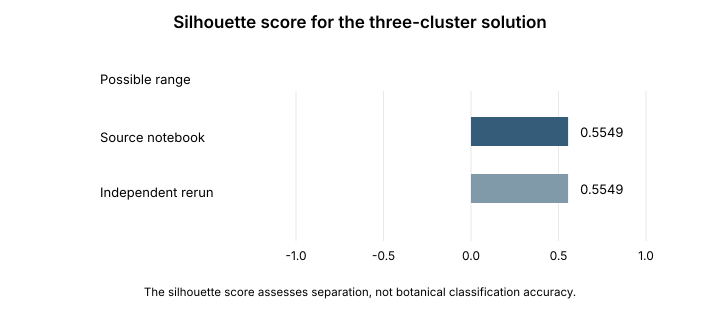
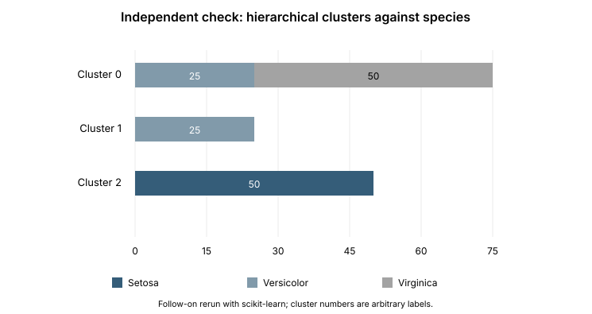

# Discovering Iris Flower Groups Through Hierarchical Clustering

**A comparison of linkage criteria, distance definitions and cluster validity**

**Amogelang R. Pelo**

## Abstract

I examine a hierarchical-clustering project that groups Iris flower observations without using species labels in model fitting. The source notebook loads 150 flowers through scikit-learn, selects **petal length and petal width**, standardises both features and displays dendrograms for single versus complete linkage under Euclidean and Manhattan distances. It then fits a three-cluster agglomerative model using complete linkage and Euclidean distance. The original notebook reports a **silhouette score of approximately 0.5549**, indicating moderate positive separation within that specification.

To assess the meaning of these groupings, I independently reproduced the clustering procedure using the documented configuration and the scikit-learn Iris loader. My rerun recovered group sizes of **75, 25 and 50**, with the 50-record group corresponding to all Setosa observations and the remaining two groups partitioning Versicolor and Virginica unevenly. An adjusted Rand index of approximately **0.636** demonstrates substantial but imperfect agreement with the known species labels. The numerical cluster IDs are arbitrary, and the supplementary species comparison was **not part of the original notebook**. I conclude that the project illustrates the role of distance and linkage choices in unsupervised learning, while showing why a positive silhouette score cannot be interpreted as proof that the clusters match real botanical categories.

**Keywords:** hierarchical clustering; agglomerative learning; Euclidean distance; Manhattan distance; single linkage; complete linkage; silhouette score; Iris dataset.

## 1. Introduction

Unsupervised learning attempts to discover structure among observations without using predefined outcome labels during fitting. Clustering is a central example: it groups observations based on a chosen notion of similarity. Hierarchical clustering adds a nested structure by repeatedly joining objects or groups and representing those joins in a dendrogram (Hastie, Tibshirani and Friedman, 2009).

The Iris dataset is a useful setting for this study because flowers have measurable sepal and petal dimensions and belong to three recorded species. The classic data problem is often used for supervised classification, but the clustering formulation asks a different question: can the measurements alone produce stable groupings with an interpretable relationship to species? The answer depends on the features selected, their scaling, the distance metric, linkage rule and the chosen number of groups (Fisher, 1936).

The repository's notebook focuses on the two petal measurements and compares four dendrogram combinations: single linkage with Euclidean distance, complete linkage with Euclidean distance, single linkage with city-block distance and complete linkage with city-block distance. Its final model fixes three groups and uses Euclidean complete-linkage agglomeration (Pelo, n.d.-a).

My research question is: **How do these clustering choices shape the grouping process, and what evidence supports the reported three-cluster result?** I address it by reviewing the original source and saved outputs, reconstructing its design and performing a clearly distinguished additional clustering check. The study is methodological rather than a biological claim about all Iris flowers.

## 2. Theoretical framework

### 2.1 Agglomerative hierarchical clustering

Agglomerative clustering starts with individual observations and iteratively combines the closest clusters according to a linkage rule. The successive merges form a hierarchy that can be displayed as a dendrogram. A dendrogram's vertical height generally represents the dissimilarity at which a merge occurs; the interpretation of that height depends on the chosen metric and linkage method (Murtagh and Contreras, 2012).

Unlike algorithms such as K-means, a hierarchical procedure constructs a sequence of nested groupings before one chooses a particular cut. The final number of clusters can be selected after inspecting the hierarchy, although in the submitted scikit-learn estimator the number is explicitly set to three.

A nested grouping need not correspond to a biologically meaningful taxonomy. Statistical proximity measures similarity in the chosen feature space rather than evidence about ancestry, genetics or species boundaries.

### 2.2 Single versus complete linkage

**Single linkage** defines the distance between two clusters by the closest pair of points, one from each cluster. It can represent elongated or connected structures, but is susceptible to chaining: separate dense regions may become joined through a succession of relatively close observations.

**Complete linkage** instead uses the most distant pair of points across two clusters. It tends to favour more compact groups because a merge must accommodate their full cross-cluster separation. However, this method can be sensitive to extreme points and may divide a continuous distribution differently from single linkage (Hastie, Tibshirani and Friedman, 2009).

The notebook's use of both methods is an important design choice. It demonstrates that the clustering result is not determined by the dataset alone. The algorithm's definition of inter-cluster distance is part of the research design.

### 2.3 Euclidean and Manhattan distances

For two observations with petal length and width coordinates, Euclidean distance is the square root of the sum of squared coordinate differences. Manhattan, or city-block, distance is the sum of the absolute coordinate differences. Both are nonnegative and symmetric, but they rank some pairs differently.

Euclidean distance makes diagonal separation behave differently from Manhattan distance, while Manhattan distance aggregates coordinate-wise deviations. The effect of choosing one over the other depends on the geometry and scaling of observations.

Because both petal features are measured in centimetres but have different numerical ranges and variability, the notebook standardises them before calculating these distances. This ensures that a difference of one standard deviation has a comparable nominal scale in each coordinate.

### 2.4 Standardisation and cluster validity

The source calls `StandardScaler` to transform the two petal measurements. The standardisation uses the feature mean and standard deviation across all 150 records, so that each transformed column has approximately zero mean and unit variance under the scaler's convention (scikit-learn developers, n.d.-a).

The **silhouette coefficient** compares how close a point is to other observations in its own cluster with how close it is to its nearest alternative cluster. Scores range from −1 to 1: higher positive values indicate stronger internal cohesion and external separation. The average silhouette provides an internal validity measure, but it does not say whether a partition reproduces independently defined species labels (Rousseeuw, 1987).

An **external** metric such as the adjusted Rand index (ARI) measures agreement between a cluster assignment and known categories while correcting for chance agreement. It is a different question from silhouette: one asks whether the geometry supports the partition; the other asks how the partition agrees with labels not used in fitting (Hubert and Arabie, 1985).

## 3. Data sources and analytical procedure

### 3.1 Dataset and selected variables

The notebook loads scikit-learn's Iris dataset with `load_iris()`, resulting in 150 observations and four numeric flower features. It selects only the **petal length and petal width** columns for clustering. The repository also has an adjacent `Iris.csv`, but the source notebook itself uses the library dataset and does not read that CSV (Pelo, n.d.-a).

The scikit-learn Iris benchmark contains 50 records from each of the Setosa, Versicolor and Virginica classes, which are available for **post-hoc evaluation**, not for fitting the unsupervised model (scikit-learn developers, n.d.-b). The distinction is central: having labels in the dataset's metadata does not mean the clustering algorithm used them.

### 3.2 Source notebook workflow

The source imports pandas, scikit-learn's dataset loader, `StandardScaler`, `AgglomerativeClustering` and `silhouette_score`, as well as SciPy's `linkage` and `dendrogram`. It constructs a two-column matrix, scales it and computes four hierarchical trees.

| Dendrogram comparison | Linkage | Distance metric |
|:--|:--|:--|
| Configuration 1 | Single | Euclidean |
| Configuration 2 | Complete | Euclidean |
| Configuration 3 | Single | Manhattan / city-block |
| Configuration 4 | Complete | Manhattan / city-block |

It then selects complete linkage and Euclidean distance for `AgglomerativeClustering(n_clusters=3, linkage="complete", metric="euclidean")`, plots the transformed measurements coloured by assigned cluster and computes the silhouette score. The original notebook's saved output prints **0.5548601998030462** (Pelo, n.d.-b).

These cells establish that several clustering definitions were visualised. They do **not** establish that the final configuration was objectively optimal, because no saved quantitative comparison of silhouette scores across all four combinations is provided.

### 3.3 Independent supplementary check

I reproduced the selected hierarchical configuration using scikit-learn's `load_iris`, `StandardScaler` and `AgglomerativeClustering` implementations. I then compared the resulting assignments with species labels using an adjusted Rand index and a cluster-by-species table. I performed this check solely as **additional analysis for the research paper**.

Software implementation details can affect tie-breaking and cluster numbering, so the numerical labels should not be treated as stable category names. My rerun yielded a silhouette value approximately 0.55486, consistent with the original saved result within minor numerical precision. The agreement calculation should be interpreted as a supplementary diagnostic, not as a previously completed student notebook experiment.

## 4. Results and descriptive analysis

### 4.1 Evidence of petal separation

The adjacent repository CSV contains 150 records, with 50 labelled flowers in each species. Its Setosa petal-length values range from 1.0 to 1.9 cm and its non-Setosa petal lengths start at 3.0 cm. Petal width also shows a gap: Setosa has values up to 0.6 cm while the other two species begin at 1.0 cm.

This strong separation helps explain why a clustering approach based on petal measurements can isolate Setosa. It does not mean that Versicolor and Virginica are equally separated. Their petal ranges overlap more substantially, giving clustering methods discretion over where to place boundaries.

The adjacent CSV is used here to describe feature ranges, while the actual clustering configuration is reproduced from the scikit-learn loader, as in the notebook. I do not silently substitute the two data sources as identical without checking the stated calculation.

### 4.2 Silhouette result

The saved notebook reports an average silhouette of **0.5549** for its final three-cluster solution. This is a positive value meaning that, on average, flowers tend to be closer to members of their own assigned cluster than to the nearest alternative cluster under the selected transformed feature space.

<figure class="chart wide"><figcaption>Figure 1. Silhouette score from the original notebook and an independent rerun of the specified three-cluster model. The score evaluates geometric grouping, not accuracy against botanical species.</figcaption></figure>

The score does not imply 55.49% of flowers were classified correctly. Silhouette is not a classification accuracy statistic and contains no ground-truth species information. It is also not comparable across datasets with different preprocessing and dissimilarity choices without appropriate methodological qualification.

### 4.3 Cluster membership and species agreement

My independent rerun with three groups recovered memberships of **75, 25 and 50**. A post-hoc comparison with known Iris labels produced the following counts; the cluster numbers are arbitrary:

| Rerun cluster | Setosa | Versicolor | Virginica | Total |
|:--|--:|--:|--:|--:|
| Cluster 0 | 0 | 25 | 50 | 75 |
| Cluster 1 | 0 | 25 | 0 | 25 |
| Cluster 2 | 50 | 0 | 0 | 50 |

<figure class="chart wide"><figcaption>Figure 2. Supplementary cluster-by-species table from an independent rerun of the complete-linkage Euclidean model. Species were used only to inspect the resulting clusters, not to train the model.</figcaption></figure>

The Setosa observations form a distinct 50-record group in this result. Versicolor is split between two groups, and all Virginica observations share a group with 25 Versicolor observations. The three clusters therefore **do not correspond one-to-one with the three species**.

The adjusted Rand index is approximately **0.636** in my rerun, indicating appreciable but imperfect agreement. This adds a more precise qualification to the original notebook's assessment of positive separation.

### 4.4 What the group structure reveals

A cluster can be internally coherent without matching externally named categories. The 75-record group mixes two botanical labels while retaining a reasonable silhouette under the chosen geometry. That outcome is not a contradiction. The clustering objective organises measured petal coordinates rather than maximising agreement with species labels.

The result also illustrates why using three groups simply because there are three species does not guarantee biologically correct separation. If the goal were to recover species, one might compare more features or different linkage rules. If the goal were purely descriptive clustering, species correspondence would be optional rather than the defining objective.

## 5. Critical methodological discussion

### 5.1 Comparing dendrograms requires more than visual preference

The notebook constructs four dendrograms that vary both linkage and metric, a useful introduction to the sensitivity of hierarchical clustering. Yet visual comparison alone does not quantify the extent to which the resulting partitions differ.

A stronger evaluation would cut each dendrogram at three groups, export assignments and report silhouette and ARI values for each combination. These metrics should be interpreted separately: silhouette describes geometric separation, while ARI describes agreement with known species. Such a table would provide evidence for the final choice of complete linkage rather than merely following a convenient example.

### 5.2 The number of groups is a modelling assumption

The code fixes `n_clusters=3`. That is understandable because the benchmark is known to have three species labels. Nonetheless, in a genuinely unsupervised setting, the number of underlying groups is unknown. The investigator should distinguish a prespecified educational target from an independently selected cluster count.

I would test a reasonable range of two to six groups and compare silhouette, dendrogram structure and cluster sizes. A very small isolated cluster may reflect a genuinely distinct subgroup or an artefact of the distance definition. Judgement should be linked to the stated research aim rather than to a desire for matching category counts.

### 5.3 Feature selection and scaling

Only two of four available flower measurements enter the clustering. This decision improves interpretability but discards potential information from sepal length and width. It may be sensible to focus on petal geometry, yet the result cannot demonstrate that those two variables form the best possible feature set.

A useful sensitivity check would compare clustering on the original two petal features, all four standardised features and a low-dimensional PCA representation. Such comparisons could reveal whether group stability depends strongly on feature choice.

Standardisation is also a design choice: it weights one standard deviation of petal length similarly to one standard deviation of petal width. This does not establish that these differences are equally important biologically. Alternative weighting schemes should be justified with domain context if used.

### 5.4 Dendrogram interpretation and ties

Hierarchical trees can contain merges at similar distances and can be sensitive to small changes in measurements. Cluster numbering after an agglomerative fit is arbitrary; the numeric label assigned to a group may change across implementations without altering its membership.

A careful report would record software versions and, where exact cluster membership matters, a stable ordered list of the record identifiers in each cluster. The dendrogram itself should have legible labels or be supplemented by a membership table for auditability.

### 5.5 The limits of statistical separation

A positive silhouette can coexist with overlap between real categories and should not be treated as validation of a biological taxonomy. Conversely, an external agreement score below one does not mean the clustering algorithm malfunctioned. It indicates that the chosen geometry and objective produce a partition differing from external labels.

The appropriate conclusion depends on the research question. As a geometric grouping exercise, the project produces moderately separated clusters. As a reconstruction of botanical species, the extra agreement check demonstrates that Setosa is recovered distinctly while Versicolor and Virginica are not fully separated.

## 6. Reproducibility and recommended extensions

### 6.1 Reproducing the submitted pipeline

The essential source sequence is:

```python
from sklearn.datasets import load_iris
from sklearn.preprocessing import StandardScaler
from sklearn.cluster import AgglomerativeClustering
from sklearn.metrics import silhouette_score

iris = load_iris()
X = iris.data[:, [2, 3]]
X_scaled = StandardScaler().fit_transform(X)
model = AgglomerativeClustering(
    n_clusters=3, linkage="complete", metric="euclidean"
)
labels = model.fit_predict(X_scaled)
score = silhouette_score(X_scaled, labels)
```

This code reproduces the stated configuration, with feature columns selected by their documented positions in the scikit-learn Iris loader. A fully reproducible project should also pin scikit-learn, SciPy and NumPy versions and save the resulting labels for comparison.

### 6.2 Additional experiments worth conducting

A stronger study would compare single, complete, average and Ward linkage where supported, with Euclidean and Manhattan distances as appropriate to each method. It should report cluster sizes, mean silhouettes, stability under perturbations and external species agreement as separate results. Such analysis would clarify whether three groups and complete linkage are genuinely preferred for the desired purpose.

These recommendations are future work; I do not present hypothetical scores for untested combinations or claim that my single supplementary rerun constitutes an exhaustive benchmark.

### 6.3 Limitations

The project uses a small benchmark dataset with sharply separated Setosa petals. Its results may not generalise to more complex botanical measurements or high-dimensional noisy data. The original notebook records one silhouette result but not numerical assignments or systematic comparison metrics. My follow-on check reproduces one configuration, and its ARI describes agreement with the source labels, not biological causation or performance on a new sample.

## 7. Conclusion

I find that the project demonstrates essential hierarchical-clustering concepts: distance definitions, linkage choices, dendrogram construction, standardisation and internal validity assessment. The original saved silhouette score of approximately **0.5549** supports a moderately separated three-cluster partition in the selected two-feature space.

The independent supplementary check shows that the final grouping is not identical to the known three-species structure. One cluster isolates all Setosa observations, while the other two divide Versicolor and combine some Versicolor records with Virginica. The adjusted Rand index of approximately **0.636** captures that partial agreement.

I would retain the project as evidence of practical unsupervised-learning proficiency, with the main lesson that **geometric cohesion and correspondence with external labels are distinct evaluation questions**. A rigorous extension should compare linkage and feature choices systematically, publish cluster memberships and document the exact computational environment.

## References

Fisher, R.A. (1936) ‘The use of multiple measurements in taxonomic problems’, *Annals of Eugenics*, 7(2), pp. 179–188.

Hastie, T., Tibshirani, R. and Friedman, J. (2009) *The Elements of Statistical Learning: Data Mining, Inference, and Prediction*. 2nd edn. New York: Springer.

Hubert, L. and Arabie, P. (1985) ‘Comparing partitions’, *Journal of Classification*, 2, pp. 193–218.

Murtagh, F. and Contreras, P. (2012) ‘Algorithms for hierarchical clustering: An overview’, *Wiley Interdisciplinary Reviews: Data Mining and Knowledge Discovery*, 2(1), pp. 86–97.

Pelo, A.R. (n.d.-a) *Hierarchical clustering in Iris: portfolio notebook*. GitHub portfolio. Available at: https://github.com/amopelo-southafrica/AI-Engineering-and-Research/blob/main/Machine-Learning/discovering-groups-with-hierarchical-clustering/hierarchical_clustering.ipynb.

Pelo, A.R. (n.d.-b) *Hierarchical clustering: original notebook and saved silhouette output*. GitHub portfolio. Available at: https://github.com/amopelo-southafrica/AI-Engineering-and-Research/blob/main/Machine-Learning/discovering-groups-with-hierarchical-clustering/hierarchical_original.ipynb.

Rousseeuw, P.J. (1987) ‘Silhouettes: A graphical aid to the interpretation and validation of cluster analysis’, *Journal of Computational and Applied Mathematics*, 20, pp. 53–65.

scikit-learn developers (n.d.-a) *StandardScaler*. scikit-learn documentation. Available at: https://scikit-learn.org/stable/modules/generated/sklearn.preprocessing.StandardScaler.html.

scikit-learn developers (n.d.-b) *The Iris dataset*. scikit-learn user guide. Available at: https://scikit-learn.org/stable/datasets/toy_dataset.html.
