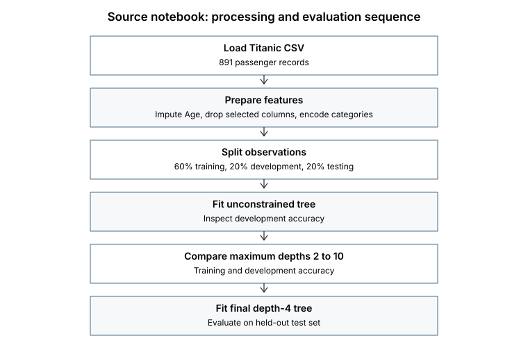
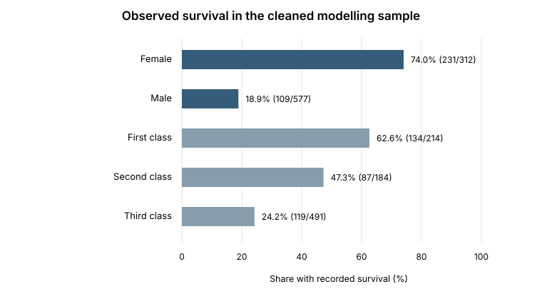

# Evaluating a Decision-Tree Approach to Titanic Survival Classification

**A source-based assessment of data preparation, depth selection and holdout evaluation**

**Amogelang R. Pelo**

## Abstract

I examine a Python machine-learning project that uses a decision-tree classifier to predict the recorded survival outcome in a Titanic passenger dataset. The repository contains 891 passenger records and two versions of the notebook, including a corrected portfolio version that adds the missing development/test split found in the original submission. The code imputes absent age values, removes selected columns, one-hot encodes categorical data, creates training, development and test sets, fits an unconstrained decision tree and compares candidate maximum depths between two and ten. It then fits a final tree constrained to depth four.

My independent source and data checks identify 177 missing ages, 687 missing cabin entries and two missing embarkation values. After the code's median-age imputation, column removal and remaining missing-value deletion, **889 rows** are available for modelling, of which **340 are recorded survivors**. The corrected split is designed to allocate approximately 60% to training, 20% to development and 20% to testing. However, the available notebooks do not retain printed development accuracy, the depth-comparison values or final test accuracy. Those metrics cannot responsibly be reported as confirmed findings. I identify two material methodological limitations: median-age imputation occurs before data splitting, and the passenger identifier remains among model predictors. I conclude that the project demonstrates the logic of model development and depth regularisation, while a reproducible performance claim requires rerunning and auditing the pipeline.

**Keywords:** decision trees; Titanic dataset; classification; model selection; train/test split; data leakage; reproducibility.

## 1. Introduction

Decision trees are supervised-learning algorithms that divide observations into subgroups according to feature-based rules. Their appeal lies in the possibility of expressing a model as a sequence of understandable decisions rather than an opaque numerical prediction. For a binary outcome such as survival, a tree can learn rules involving passenger characteristics and assign each resulting leaf a class label (Breiman *et al.*, 1984).

A useful predictive model must do more than memorise the training observations. It should be evaluated on records that were not used to fit or select its parameters. A fully developed tree can achieve very high training accuracy while performing less well outside the training sample, especially when data are limited and the model can keep splitting on small distinctions (Hastie, Tibshirani and Friedman, 2009).

The source project applies this method to Titanic passenger records. It includes data preparation, a random train/development/test partition, an unconstrained tree, a comparison of maximum depths and a final model specified with `max_depth=4`. Its stated goal is to understand survival patterns through classification and assess the influence of tree complexity on accuracy (Pelo, n.d.-a).

My research question is: **Does the documented pipeline support a credible evaluation of a decision tree, and what must be corrected before its performance can be interpreted confidently?** I investigate the code and the associated dataset, separating source-visible procedures from measurable descriptive facts and from claims that would require re-execution.

This research paper does not imply that a fitted model can explain historical rescue decisions causally. Predictive classification can exploit observed associations without identifying the mechanisms that produced the outcomes. The model is best regarded as an educational exercise in classification and validation.

## 2. Conceptual and statistical framework

### 2.1 Recursive partitioning

A classification tree repeatedly partitions a feature space into smaller groups. At each split, the algorithm evaluates whether dividing observations on a feature improves a criterion of class purity. Under the default scikit-learn `DecisionTreeClassifier`, the criterion is Gini impurity unless a different option is specified (scikit-learn developers, n.d.-a).

For a binary node with survival proportion `p`, Gini impurity is **1 − p² − (1−p)²**. The impurity is zero when all observations belong to one class and reaches its binary maximum when the classes are equally represented. Candidate splits are judged according to how much they reduce weighted impurity.

A tree can represent nonlinear decision boundaries and feature interactions without requiring a single linear relationship. These characteristics help explain its popularity for teaching classification. They do not guarantee that each split is stable or meaningful outside the observed sample (Breiman *et al.*, 1984).

### 2.2 Depth, variance and overfitting

Maximum depth controls the longest sequence of rules from the root to a leaf. A shallow tree is easier to interpret and tends to have lower complexity, but may miss meaningful structure. A deep tree can fit intricate patterns and noise. The trade-off is commonly described through model bias and variance (Hastie, Tibshirani and Friedman, 2009).

The notebook tests maximum depths from **2 through 10** and records training and development accuracy for each candidate. The intended comparison is important because increasing training accuracy is not sufficient evidence of improving generalisation. A depth should be chosen according to an evaluation criterion established on data reserved for model development.

The source then fixes the final depth at four. That choice is visible in code. Without the actual recorded development scores, however, I cannot verify the accompanying prose assertion that depth four was the highest-performing development choice.

### 2.3 Training, development and test separation

The source allocates 40% of preprocessed observations to a temporary pool. It then divides that pool evenly into development and final test sets, which yields the intended **60/20/20** allocation. The first split uses `random_state=42` and the second also uses `random_state=42` (Pelo, n.d.-a).

The development set is intended for comparing model configurations. The final test set should provide a later, relatively independent assessment after model selection. Such separation is conceptually appropriate, but it can be undermined if data-dependent preprocessing uses information from all records before the split.

Scikit-learn's guidance recommends partitioning data before fitting transformations such as imputers or scalers, and applying the learned transformation only to held-out records (scikit-learn developers, n.d.-b). This is particularly relevant to the source notebook's age-imputation step.

### 2.4 Accuracy and additional metrics

Classification accuracy is the proportion of predictions matching their recorded labels. For a binary survival outcome, an overall accuracy value does not show how errors differ for passengers who survived versus those who did not. A confusion matrix, precision, recall and balanced accuracy can provide more detail about the types of classification error (James *et al.*, 2021).

The source notebook imports and computes `accuracy_score` for development and final test predictions, but it does not retain a confusion matrix or class-wise metrics in the versions examined. Any practical assessment of its results would benefit from those additional diagnostics.

## 3. Source material and methodology

### 3.1 Repository materials

I examined the project README, `titanic-decision-tree.ipynb`, `titanic_tree_original.ipynb` and the included `titanic.csv`. The README describes the purpose of the task and notes that the published portfolio notebook corrects missing split variables from the original notebook (Pelo, n.d.-a; Pelo, n.d.-b).

The original notebook creates `X_temp` and `y_temp` but later attempts to use `X_dev`, `y_dev`, `X_test` and `y_test` without creating them. The corrected portfolio notebook includes the second `train_test_split` call that constructs those development and test subsets. This is a substantive reproducibility correction: without it, the later evaluation cells cannot run in sequence.

### 3.2 Data composition and missing information

The CSV contains 891 records and 12 columns, including survival outcome, passenger class, recorded sex, age, fare, family counts and identifiers. My direct checks find 177 blank `Age` values, 687 blank `Cabin` values and two blank `Embarked` values.

| Data property | Value | Role in source pipeline |
|:--|--:|:--|
| Initial passenger rows | 891 | Starting dataset |
| Missing age entries | 177 | Filled using the median age |
| Missing cabin entries | 687 | Cabin column dropped |
| Missing embarkation entries | 2 | Rows removed after `dropna()` |
| Cleaned records | 889 | Candidate modelling observations |
| Survivors after cleaning | 340 | Positive outcome |
| Non-survivors after cleaning | 549 | Negative outcome |

The two records removed after the cleaning operations are recorded survivors in the project file. Thus cleaning reduces the positive count from 342 to 340 while leaving the non-survivor count at 549. I report this as a source-data verification, not as an independently fitted classification result.

### 3.3 Implementation sequence

The code reads the Titanic CSV and replaces missing ages with the median of the observed `Age` values. It removes the columns `Cabin`, `Ticket` and `Name`, deletes any remaining incomplete rows, and converts `Sex` and `Embarked` into dummy variables using pandas `get_dummies(..., drop_first=True)`. It then defines `X` by removing `Survived` and defines `y` as that outcome column.

<figure class="chart wide"><figcaption>Figure 1. Analysis sequence reconstructed from the corrected notebook. The flow diagram describes implemented code, not a newly executed training experiment.</figcaption></figure>

The notebook first fits a `DecisionTreeClassifier(random_state=42)` without an explicit depth limit. It plots the tree and computes development accuracy. It subsequently loops through candidate maximum depths 2–10, comparing training and development accuracy, and fits a separate final classifier with `max_depth=4`.

### 3.4 Scope of the static review

I do not claim to have executed a new model or obtained classification accuracy not recorded in the supplied notebooks. The notebook versions reviewed contain code for printing results, but the execution-output fields do not provide the relevant numerical accuracy values. The paper therefore examines the **design and reproducibility of the evaluation**, supplemented by descriptive checks on the source CSV.

This distinction prevents an unsupported statement such as “the model achieved 85% test accuracy” from appearing in the research report. An accuracy value should be included only after the exact software environment, data preparation and execution are documented.

## 4. Data characteristics and model inputs

### 4.1 Distribution of the cleaned target

Of the 889 rows retained after preparation, 340 are recorded survivors and 549 are non-survivors. The survival share in the cleaned sample is approximately **38.25%** and the non-survival share is approximately **61.75%**.

An always-predict-non-survival baseline would therefore achieve about **61.75% accuracy on the full cleaned dataset**. That value is a descriptive majority-class benchmark, not the held-out score of a trained classifier. A fair comparison on development or test sets should calculate the baseline from the relevant training labels and evaluate it on the corresponding held-out observations.

### 4.2 Group-level context

The source dataset includes variables with observable associations to the target. After removing the two incomplete `Embarked` records, female passengers have 231 survivors out of 312 records, while male passengers have 109 survivors out of 577. By class, first-class passengers have 134 survivors out of 214; second-class passengers have 87 out of 184; and third-class passengers have 119 out of 491.

<figure class="chart wide"><figcaption>Figure 2. Descriptive survival rates in the 889-record cleaned dataset. These associations are calculated directly from the CSV and are not model training or prediction metrics.</figcaption></figure>

These differences help explain why recorded sex and class can be informative features for a tree. They do not establish which feature the fitted tree actually uses at each split, because the notebook does not preserve a textual listing of its learned rules or a saved fitted estimator.

### 4.3 Feature selection and identifier risk

The source removes `Cabin`, `Ticket` and `Name`, but it retains `PassengerId`. An identifier is not ordinarily a meaningful physical or social characteristic of a passenger. A decision tree can nevertheless split on numerical identifiers if doing so appears to reduce training impurity. Such a split may exploit arbitrary ordering in the dataset rather than a transferable relationship.

I would drop `PassengerId` before fitting a predictive model unless there is a defensible, documented reason to include it. This is a concrete improvement to the source feature specification. It does not imply that the trained tree necessarily selected the identifier, since its actual split structure has not been audited here.

### 4.4 Preprocessing before the split

Age imputation uses `df["Age"].median()` computed on the full data **before** the training/development/test partition. In the strict evaluation sense, the observed age distribution of development and test records may influence the imputed values applied to training examples. This is a form of preprocessing leakage, although the practical size of any resulting bias in this dataset has not been measured.

One-hot encoding also occurs before splitting. Encoding a feature's observed categories across all rows need not by itself leak outcome labels, but a production-quality pipeline should learn and apply preprocessing within a training-fitted transformer to avoid inconsistencies between datasets and to handle unseen categories. This arrangement also reduces the risk of accidentally incorporating held-out information in future steps (scikit-learn developers, n.d.-b).

## 5. Evaluation design and depth selection

### 5.1 Interpreting the intended depth comparison

The loop over `range(2, 11)` creates nine candidate tree depths. Each candidate is trained on the training partition, and accuracy is calculated on training and development observations. The resulting plot is intended to reveal whether added depth improves development performance or merely increases training fit.

This is an appropriate educational approach to model-complexity assessment. However, the absence of numerical output means the paper cannot state which depth was actually best. A figure showing invented accuracy values would be misleading. I therefore describe the comparison design rather than reconstructing unobserved scores.

### 5.2 The fixed final depth

The final code fits a depth-four tree and predicts on the test set. It then calls `accuracy_score(y_test, y_test_pred)`. The accompanying markdown claims the selected depth achieved strong performance, but does not give a score. Because a claim of “strong” accuracy has no recorded denominator, confusion matrix or held-out metric, it remains an interpretation requiring verification.

A sound model-selection report would list development results for each depth, identify the selected depth by an explicit rule, and present final test performance only once after selection. Where several depths tie on the development set, a stated tie-breaker—often favouring the simpler tree—would support repeatability.

### 5.3 Training, development and test sizes

For the 889 cleaned observations, the code's first split allocates roughly 60% to training and 40% to temporary data. A second 50:50 division of the temporary set produces development and test partitions. Under scikit-learn's rounding rules, this yields **533 training, 178 development and 178 test observations**.

These are split sizes implied by the code and row count. I do not assert the number of survivors in each split without executing the corresponding partition, and I do not claim that all three sets preserve the same class proportions. The source does not specify `stratify=y`, so proportions can vary under random sampling.

### 5.4 Recommended evaluation table

The following table shows the evidence that a complete follow-on evaluation should capture. Empty result descriptions are not estimates.

| Evaluation item | Status in source | What a completed report should provide |
|:--|:--|:--|
| Unconstrained-tree development accuracy | Computation coded; number not retained | Actual count and percentage |
| Depths 2–10 | Comparison coded; values not retained | Train/dev score table and plot |
| Selected depth | Fixed at 4 | Evidence of selection from development data |
| Final held-out test accuracy | Computation coded; number not retained | Exact score and denominator |
| Confusion matrix | Not included | Error distribution by outcome |
| Majority-class comparator | Not included | Baseline on same held-out set |
| Leakage-free preprocessing | Not implemented | Split-first imputation and encoding |

The table is an audit checklist, not a claim that all these evaluations have already been carried out.

## 6. Methodological critique and improvements

### 6.1 Build a leakage-resistant pipeline

I would separate the raw data into training, development and test partitions before computing imputation statistics. Then I would fit the imputer and categorical encoder on training records only, using the same fitted transformations on development and test records.

A scikit-learn `Pipeline` with a `ColumnTransformer`, numerical `SimpleImputer` and categorical `OneHotEncoder(handle_unknown="ignore")` can enforce this structure and make the trained preprocessing part of the model artefact (scikit-learn developers, n.d.-b). This would also make it easier to audit feature names and prevent accidental use of the passenger identifier.

### 6.2 Compare models with reproducible metrics

For each candidate depth, a reproducible study should capture training and development accuracy, number of leaves and tree depth. I would also record a confusion matrix and balanced accuracy. Where the majority class is appreciably more frequent, balanced accuracy helps prevent a high overall score from hiding weak performance on the minority class.

The final test set should remain untouched until a depth has been chosen. If the code is revised after inspecting test results, the test has implicitly become part of model development; a new independent test or properly nested validation design would be required for an unbiased final assessment (Hastie, Tibshirani and Friedman, 2009).

### 6.3 Evaluate model stability

A single split provides one performance observation for a particular random partition. Repeated stratified cross-validation on the training/development portion would provide a clearer view of variation across folds. It could also reveal whether different folds select substantially different decision-tree structures even when accuracy is similar.

I would document package versions, the input-file checksum, random seeds, feature transformations, the selection criterion and final evaluation data. These details are essential when a paper claims a particular numerical result can be reproduced from a source repository.

### 6.4 Interpretation and responsible use

Even if a tree predicts the Titanic dataset's outcome with high accuracy, this does not show that its splitting features were causes of historical survival. Features such as passenger class and recorded sex may be proxies for processes not directly captured in the file. A model's predictive split rule is a statistical association, not a natural experiment.

Moreover, the dataset is an educational historical sample. It should not be presented as a validated decision tool for real maritime safety, emergency evacuation or insurance. The more appropriate learning objective is to understand how predictive models are trained, constrained and evaluated.

## 7. Conclusion

I find that the corrected notebook contains the essential elements of a supervised-learning exercise: data preparation, categorical encoding, separate development and final test partitions, an unconstrained decision tree, and a comparison of depth-limited models. The source CSV supports a reproducible description of the 889 records retained after cleaning, including 340 survivor labels and substantial observed variation by passenger group.

The strongest methodological concerns are the computation of median age before partitioning the data, the retention of an arbitrary passenger identifier as a predictor and the absence of retained numerical evidence supporting the notebook's assertions about optimal depth and final performance. Those limitations do not erase the educational contribution of the project; they define the next steps required for a defensible research claim.

I would improve the project by moving preprocessing into training-fitted transformers, removing identifiers, recording candidate-depth scores and producing final test metrics with class-wise error analysis. Until such a rerun is documented, the responsible conclusion is that the **model-building method is visible and auditable, but its predictive performance is not verified from the saved project outputs**.

## References

Breiman, L., Friedman, J.H., Olshen, R.A. and Stone, C.J. (1984) *Classification and Regression Trees*. Belmont, CA: Wadsworth.

Hastie, T., Tibshirani, R. and Friedman, J. (2009) *The Elements of Statistical Learning: Data Mining, Inference, and Prediction*. 2nd edn. New York: Springer.

James, G., Witten, D., Hastie, T. and Tibshirani, R. (2021) *An Introduction to Statistical Learning: With Applications in R*. 2nd edn. New York: Springer.

Pelo, A.R. (n.d.-a) *Titanic decision tree: corrected portfolio notebook*. GitHub portfolio. Available at: https://github.com/amopelo-southafrica/AI-Engineering-and-Research/blob/main/Machine-Learning/explaining-titanic-survival-with-trees/titanic-decision-tree.ipynb.

Pelo, A.R. (n.d.-b) *Titanic decision tree: original notebook*. GitHub portfolio. Available at: https://github.com/amopelo-southafrica/AI-Engineering-and-Research/blob/main/Machine-Learning/explaining-titanic-survival-with-trees/titanic_tree_original.ipynb.

Pelo, A.R. (n.d.-c) *titanic.csv: accompanying dataset*. GitHub portfolio. Available at: https://github.com/amopelo-southafrica/AI-Engineering-and-Research/blob/main/Machine-Learning/explaining-titanic-survival-with-trees/titanic.csv.

scikit-learn developers (n.d.-a) *DecisionTreeClassifier*. scikit-learn documentation. Available at: https://scikit-learn.org/stable/modules/generated/sklearn.tree.DecisionTreeClassifier.html.

scikit-learn developers (n.d.-b) *Common pitfalls and recommended practices*. scikit-learn user guide. Available at: https://scikit-learn.org/stable/common_pitfalls.html.
