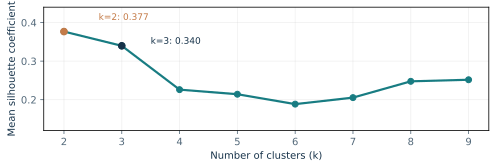
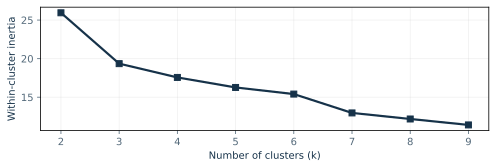
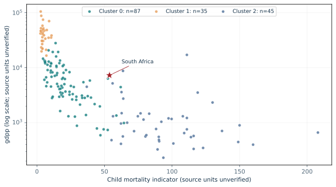

# Patterns Across National Development Indicators

**A K-means study of 167 country records**

**Amogelang R. Pelo**

*This study is based on the original project notebook and its accompanying dataset. Additional analyses are identified separately from the original implementation.*

## Table of contents

1. Abstract and research problem
2. Theory and analytical framework
3. Dataset and original implementation
4. Quantitative model selection
5. Three-cluster empirical profiles
6. Sensitivity tests and reproducibility
7. Interpretation and decision boundaries
8. Conclusion and reproducible protocol
9. References

---

## Abstract
In this study, I examine whether national economic, demographic and health-related indicators can reveal meaningful groups of countries through unsupervised machine learning. It reproduces and critically evaluates a Python/Jupyter K-means project using the accompanying `Country-data.csv` file. The dataset contains **167 country records and nine numerical indicators**; no missing values were detected. The project applies Min-Max scaling, evaluates cluster counts from two to nine, and selects a three-cluster model for interpretation (Pelo, 2026; Dataset accompanying Pelo, n.d.).

My reproduction yields a **three-cluster silhouette coefficient of 0.340**, compared with **0.377 for two clusters**. The three-group solution yields distinct median profiles for economic output, child mortality, life expectancy and fertility, but the higher two-cluster score indicates a tension between separation and substantive interpretability. Differences in algorithm settings, indicator definitions and dataset provenance restrict external claims. These clusters should be treated as exploratory **descriptions**, not official country classifications or measures of national worth.

**Keywords:** K-means; economic indicators; clustering; silhouette analysis; data science; reproducibility.

## 1. Introduction
National development is multidimensional: economic output, health outcomes, population structure and trade characteristics may vary together or diverge. Traditional single-variable rankings obscure these relationships. Exploratory clustering offers a way to group observations with similar *measured* characteristics without preassigning category labels (Jain, 2010).

The underlying student project asks whether a set of macroeconomic and social indicators can reveal patterns across countries. Its pipeline first visualises the relationship between individual features and `gdpp`, then normalises numerical variables, investigates candidate cluster counts, and plots the resulting groups (Pelo, 2026).

**Research question:** *What country profiles emerge from K-means applied to the nine included numerical indicators, and how sensitive are those profiles to model selection and scaling choices?*

My contribution is a traceable assessment of that implementation: the input data are examined, model quality is quantified, group profiles are described, and methodological limitations are made explicit. It does not test causal hypotheses about why countries differ.


## 2. Theoretical and methodological framework
### 2.1 Unsupervised grouping
K-means partitions numerical observations into a specified number, *k*, of groups by iteratively assigning observations to nearby centroids and updating those centroids. The objective is to reduce the within-cluster sum of squared Euclidean distances, commonly reported as **inertia** (MacQueen, 1967; scikit-learn developers, 2026a). In contrast with supervised learning, there is no observed target label against which predictive accuracy can be computed.

The approach is computationally accessible and produces interpretable centroids. However, K-means does **not** prove that clusters occur naturally in a dataset. It favours relatively compact structures under Euclidean distance and can be influenced by outliers, variable choice and the number of initialisations (Jain, 2010).

### 2.2 Scaling and measurement
The nine indicators have incompatible numerical ranges. For example, `gdpp` reaches 105,000, while `total_fer` ranges from 1.15 to 7.49. Without scaling, squared Euclidean distance would be dominated by the largest-magnitude variables. The source notebook therefore uses **MinMaxScaler**, mapping each input feature to the interval [0, 1] using its observed minimum and maximum (Pelo, 2026; Pedregosa *et al.*, 2011).

Min-Max scaling equalises numerical spans, not conceptual importance. A narrow range, measurement error or extreme observation may still determine the geometry of the model. Nor does it remove dependence among indicators such as income and `gdpp`, which can effectively increase the weight of related dimensions.

### 2.3 Choosing the number of clusters
Two complementary diagnostics are used. Inertia decreases as *k* increases, so an **elbow plot** asks whether the rate of improvement visibly weakens. The **silhouette coefficient** compares an observation's within-cluster cohesion with the distance to the next-nearest cluster; larger average values generally indicate better separation (Rousseeuw, 1987).

No selection rule is definitive. A larger silhouette can favour a simpler partition, whereas three or more clusters may support clearer domain-specific interpretation. These choices should be declared, rather than retroactively treating a preferred number as uniquely correct.

### 2.4 Algorithmic reproducibility
K-means++ initialisation was developed to improve the choice of starting centroids (Arthur and Vassilvitskii, 2007). The notebook fixes `random_state=42` but leaves `n_init` at the installed library's default. Because defaults can change, recording the software version and explicit initialisation count is essential for an exact computational replication (scikit-learn developers, 2026a).


## 3. Dataset and research design
### 3.1 Unit of analysis and variables
The unit of analysis is one named country record. The file contains **167 unique country names**, **nine numeric columns** and one text identifier, `country`. Direct checks found **zero missing cells** and **zero duplicate country names**. The data were not treated as current official statistics: no accompanying metadata establishes collection year, original providers, purchasing-power adjustment or measurement conventions (Dataset accompanying Pelo, n.d.).

| Analytical domain | Source columns | Role in study |
|:--|:--|:--|
| Health and demography | `child_mort`, `health`, `life_expec`, `total_fer` | Mortality, spending and demographic contrasts |
| Economy and prices | `income`, `gdpp`, `inflation` | Income, output and price-level variation |
| External transactions | `exports`, `imports` | Trade-related patterns |

The field `gdpp` appears to denote a per-person GDP measure, but its **currency, base year and units are unverified**. Accordingly, reported medians retain the source field name. The same caution applies to the units of other indicators.

### 3.2 Reconstructed workflow
The notebook imports the CSV with pandas, selects numeric columns, displays scatterplots against `gdpp`, and scales the nine features. It then fits K-means for *k* = 2 to 9, plots inertia, computes silhouette scores, fits *k* = 3 with `random_state=42`, and visualises results against child mortality, inflation and `gdpp` (Pelo, 2026).

**Analysis pipeline**

`Country-data.csv`  →  numeric feature selection  →  Min-Max normalisation  →  K=2…9 diagnostics  →  K=3 fit  →  descriptive profiling

### 3.3 Reproduction and extensions
I independently reproduced the model using the project dataset in **Python, pandas and scikit-learn 1.8.0**. Its first model sets match the notebook's visible instructions, including the fixed random seed and default `n_init`. Additional analyses—cluster medians, alternative `n_init` values, alternative scalers and outlier removal—are **new sensitivity checks**, not claims that the original notebook performed them.

No train/test split is required for descriptive clustering, but that fact does not imply validation: the model can be reproducible without yielding stable or substantively useful categories. Results below reflect the supplied dataset, not an independently verified real-world population.


## 4. Experimental results: model selection
The silhouette comparison identifies **k = 2 as the strongest of the tested values** (0.3767). The notebook's selected **k = 3** solution has a score of **0.3398**. This is a modest, not catastrophic, reduction in separation and may be justified if the added group has distinct, useful attributes. A high score alone does not establish normative or policy validity (Rousseeuw, 1987).

<figure class="chart wide"><figcaption>Figure 1. Mean silhouette coefficient by number of clusters. Computed from the supplied CSV with scikit-learn 1.8.0; seed = 42.</figcaption></figure>

The **inertia curve** also falls with each added cluster. Inertia is 25.947 for two clusters, 19.352 for three, and 17.563 for four. Moving from two to three reduces within-cluster inertia by approximately **25.4%**; the three-to-four reduction is approximately **9.2%**. This supports three as a plausible point of diminishing returns, though the plot does not determine an objectively correct number.

<figure class="chart wide"><figcaption>Figure 2. Inertia across candidate cluster counts. A decreasing curve is expected and is not itself a test of validity.</figcaption></figure>

**Interpretation:** selection rests on two criteria in tension. If separation is paramount, **two** is better supported by the silhouette evidence. If the research goal is to distinguish a middle profile from the extremes, **three** offers greater descriptive resolution. The results should therefore be presented as a conditional model choice, not as a proven taxonomy.


## 5. Characteristics of the three-cluster solution
The chosen three-cluster fit assigns **87 countries to Cluster 0, 35 to Cluster 1, and 45 to Cluster 2**. Number labels are generated by the software and have no ordered meaning. To interpret the groups, the table below reports within-group medians; medians are more resistant to unusually high values than means.

| Variable (median) | Cluster 0 (n=87) | Cluster 1 (n=35) | Cluster 2 (n=45) |
|:--|--:|--:|--:|
| `gdpp` | 5,020 | 41,800 | 769 |
| `income` | 10,500 | 40,400 | 1,850 |
| `child_mort` | 18.6 | 4.2 | 90.3 |
| `life_expec` | 73.5 | 80.4 | 60.1 |
| `total_fer` | 2.2 | 1.8 | 5.1 |
| `inflation` | 6.0 | 1.2 | 9.2 |

<figure class="chart wide"><figcaption>Figure 3. Original-style two-variable cluster view, reproduced with a logarithmic vertical scale for legibility. The actual K-means fit uses all nine scaled features; this two-dimensional view is only illustrative.</figcaption></figure>

**Cluster 1** combines the highest median `gdpp` and `income` with the lowest median child mortality and longest life expectancy in this dataset. **Cluster 2** is characterised by substantially lower economic measures, higher mortality and higher fertility. **Cluster 0** contains the largest and broadest intermediate grouping, including South Africa. These profiles identify statistical associations within the file; they do not imply any country's status is fixed or determined by the model (Jain, 2010).


## 6. Robustness and sensitivity analysis
### 6.1 Initialisation and software settings
With the notebook's parameterisation under scikit-learn 1.8.0, the three groups contain 87, 35 and 45 records and produce silhouette **0.3398**. Explicitly requiring 10 initialisations gives silhouette **0.3427**, with group sizes 87, 46 and 34. Requiring 30 gives **0.3393**, with 86, 46 and 35. Label numbers cannot be compared directly across fits; the **adjusted Rand index (ARI)** measures similarity after allowing for label permutations.

| Sensitivity scenario | Silhouette | ARI against baseline | Key implication |
|:--|--:|--:|:--|
| Original-style `n_init` default | 0.340 | 1.000 | Baseline result |
| `n_init=10` | 0.343 | 0.962 | Small assignment differences |
| `n_init=30` | 0.339 | 0.980 | Similar partitions |
| StandardScaler; `n_init=10` | 0.283 | 0.942 | Some scale dependence |
| RobustScaler; `n_init=10` | 0.280 | 0.780 | More substantial reassignment |

These figures show reasonable stability under multiple centroid initialisations but weaker stability under changes in the distance geometry. They also demonstrate why a fixed random seed alone is insufficient to define the entire statistical procedure (Arthur and Vassilvitskii, 2007; scikit-learn developers, 2026a).

### 6.2 Influence of extreme records
After excluding **Luxembourg** and refitting the scaling and clustering pipeline, the three-cluster silhouette rises to **0.3520** and shared-record ARI is **0.943**. Excluding **Nigeria** instead produces silhouette **0.3196** and ARI **0.980**. Excluding Luxembourg, Nigeria and Singapore jointly produces silhouette **0.3170** and ARI **0.961**. In each case the input min/max boundaries change, so the tests measure the effect of removal and rescaling together.

The sensitivity exercises are not grounds to discard unusual countries. They identify a property of the method: using observed extrema to define distance can make the partition sensitive to a small number of cases. A more mature study would pre-register variable transformations, compare alternatives and assess stability through resampling (Jain, 2010).


## 7. Discussion: what the groupings can and cannot say
### 7.1 The intermediate group is heterogeneous
Cluster 0 includes diverse combinations of economic output and health outcomes. For example, **South Africa** has `gdpp` **7,280** against its cluster median **5,020**, but `life_expec` **54.3** against the cluster median **73.5**, and `child_mort` **53.7** against **18.6**. These contrasts show that a country can be close to a multivariate centroid while diverging sharply on selected variables. The example refers strictly to the historical and undocumented project dataset, **not to present-day South African statistics**.

This matters for communication. A country represented as belonging to a 'middle' cluster is not necessarily middle-ranked on every indicator. A model that compresses nine dimensions into one label inevitably hides within-cluster variation. The country-specific data should therefore accompany labels whenever the result is used to prioritise research questions.

### 7.2 Correlation and circular interpretation
Across the full supplied dataset, `income` and `gdpp` are positively correlated (**r = 0.896**), and child mortality and life expectancy are strongly negatively correlated (**r = -0.887**). Because K-means uses both members of each pair as features, related dimensions influence the Euclidean distance more than once. Such dependence is not intrinsically wrong, but it is a modelling choice that should be justified or sensitivity-tested (Jain, 2010).

The resulting clusters are **descriptive categories**, not estimates of causal relationships. One cannot conclude that higher output *causes* better health outcomes, that trade openness determines fertility, or that cluster membership forecasts national economic performance. The input is cross-sectional and its source dates are unknown.

### 7.3 Ethical and analytical boundaries
Countries are not interchangeable units; population size, data quality, historical context and statistical definitions differ. The algorithm gives each record the same weight, regardless of population. Decisions on allocation of aid or investment would require validated current data, transparent objectives and substantive expert oversight. In particular, phrases such as 'developed' and 'underdeveloped' should not be assigned mechanically to cluster numbers.

The project is strongest when understood as a demonstration of **feature preparation, unsupervised modelling and critical interpretation**, and weakest when presented as an authoritative global ranking (Rousseeuw, 1987; Jain, 2010).


## 8. Conclusions and next-stage research
The project implements a coherent unsupervised-learning workflow: select nine indicators, normalise features, compare candidate cluster counts, fit K-means, and inspect the resulting observations. The independently reproduced evidence shows that a three-group solution produces **distinct central tendencies** and a mean silhouette of **0.340**, but that the two-group alternative has stronger separation at **0.377**. The three-group result is therefore best defended as an *interpretability choice* rather than a numerical optimum (Pelo, 2026; Rousseeuw, 1987).

Two findings are particularly important. First, descriptive medians differ substantially across the three groups, especially for `gdpp`, mortality and life expectancy; second, the model is not wholly invariant to scaling choices or extreme records. Together these findings support a balanced conclusion: K-means identifies useful patterns in the supplied observations, but **the pattern depends on decisions made by the analyst**.

### 8.1 Reproduction protocol
The entire analysis is traceable to the GitHub folder linked below. To replicate my baseline analysis: (1) load the original CSV; (2) select the nine numeric columns; (3) apply Min-Max normalisation; (4) fit `KMeans(n_clusters=k, random_state=42)` for k = 2 to 9; (5) compute inertia and the silhouette coefficient; (6) fit k = 3 and describe the assigned groups. Record **Python version, pandas version, scikit-learn version and `n_init`** because software defaults may change (Pedregosa *et al.*, 2011; scikit-learn developers, 2026a).

A practical reproducibility command sequence is:

```text
python -m pip install pandas numpy scikit-learn matplotlib jupyter
jupyter notebook country_kmeans_clustering.ipynb
```

These commands demonstrate the project environment; exact dependencies should ideally be pinned before publication. The repository's CSV and notebook are the source files. My additional statistics, robust-scaling tests and outlier analysis are **independent follow-on calculations**, not modifications to the student's original code.

### 8.2 Recommended extensions
A publication-ready follow-up should establish the source and date of every indicator, report units and missing-data rules, compare two and three clusters with a predeclared criterion, test transformations of heavy-tailed variables, measure stability across repeated samples and explicitly evaluate whether each cluster conveys an actionable insight. Only then would the classifications be candidates for use beyond coursework.

**Project source:** [Original notebook and dataset](https://github.com/amopelo-southafrica/AI-Engineering-and-Research/tree/main/Machine-Learning/exploring-country-development-clusters)

---

## References

Arthur, D. and Vassilvitskii, S. (2007) ‘k-means++: The advantages of careful seeding’, *Proceedings of the Eighteenth Annual ACM-SIAM Symposium on Discrete Algorithms*, pp. 1027–1035. Available at: https://research.google/pubs/k-means-the-advantages-of-careful-seeding/.

Dataset accompanying Pelo, A.R. (n.d.) *Country-data.csv*, in ‘Exploring Country Development Clusters’. GitHub project dataset. Available at: https://github.com/amopelo-southafrica/AI-Engineering-and-Research/blob/main/Machine-Learning/exploring-country-development-clusters/Country-data.csv. Original data producer, observation years and definitions are not documented in the file.

Jain, A.K. (2010) ‘Data clustering: 50 years beyond K-means’, *Pattern Recognition Letters*, 31(8), pp. 651–666. doi: 10.1016/j.patrec.2009.09.011.

MacQueen, J. (1967) ‘Some methods for classification and analysis of multivariate observations’, *Proceedings of the Fifth Berkeley Symposium on Mathematical Statistics and Probability*, Vol. 1, pp. 281–297. Available at: https://digicoll.lib.berkeley.edu/record/113015.

Pedregosa, F. *et al.* (2011) ‘Scikit-learn: Machine learning in Python’, *Journal of Machine Learning Research*, 12, pp. 2825–2830. Available at: https://jmlr.org/papers/v12/pedregosa11a.html.

Pelo, A.R. (2026) *Country Development Clustering with K-means: original Jupyter notebook*. GitHub portfolio. Available at: https://github.com/amopelo-southafrica/AI-Engineering-and-Research/blob/main/Machine-Learning/exploring-country-development-clusters/country_kmeans_clustering.ipynb.

Rousseeuw, P.J. (1987) ‘Silhouettes: A graphical aid to the interpretation and validation of cluster analysis’, *Journal of Computational and Applied Mathematics*, 20, pp. 53–65. doi: 10.1016/0377-0427(87)90125-7.

scikit-learn developers (2026a) ‘KMeans’, *scikit-learn documentation*. Available at: https://scikit-learn.org/stable/modules/generated/sklearn.cluster.KMeans.html.

scikit-learn developers (2026b) ‘silhouette_score’, *scikit-learn documentation*. Available at: https://scikit-learn.org/stable/modules/generated/sklearn.metrics.silhouette_score.