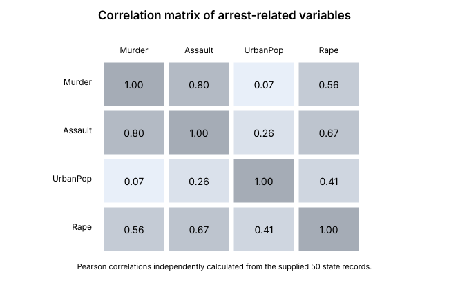
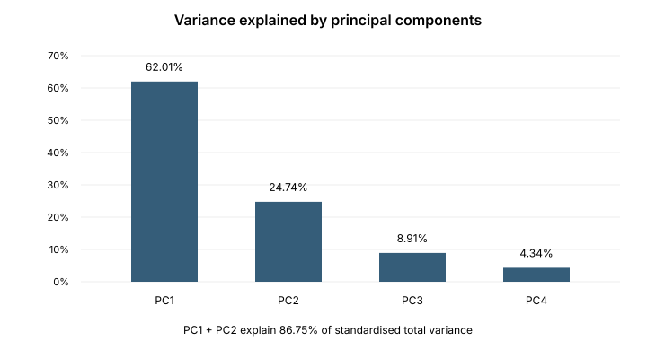

# Principal Component Analysis and Clustering of US Arrest Records

**A source-based evaluation of dimensionality reduction and state-level grouping**

**Amogelang R. Pelo**

## Abstract

I investigate a machine-learning project that applies principal component analysis (PCA), K-means and hierarchical clustering to the `USArrests` dataset of 50 United States states. The source notebook standardises four numeric variables—murder arrests, assault arrests, percentage urban population and rape arrests—before fitting PCA. Its preserved execution output reports explained-variance proportions of **0.6201**, **0.2474**, **0.0891** and **0.0434** for the four principal components. Thus the first two components retain approximately **86.75%** of the variation in the standardised variables. The source then applies K-means with three clusters to the two-dimensional scores and constructs a Ward-linkage dendrogram.

I independently checked the supplied CSV and computed descriptive variances and pairwise correlations. The correlation between Murder and Assault is approximately **0.802**, while Murder and UrbanPop have a much weaker correlation of approximately **0.070**. These results help explain why PCA can summarise shared variation across arrest measures. However, cluster labels are algorithmic descriptions of a historical dataset rather than natural or causal state categories. The notebook does not retain cluster membership, silhouette measurements or a quantitative agreement comparison between K-means and hierarchical clustering. I conclude that the project demonstrates a coherent unsupervised-learning workflow while requiring additional validation and contextual caution before broad state-level interpretation.

**Keywords:** principal component analysis; USArrests; K-means; hierarchical clustering; Ward linkage; standardisation; unsupervised learning.

## 1. Introduction

Multivariate data often contain variables measured on different scales, with relationships that can obscure their joint structure. Principal component analysis provides a way to express several correlated variables through a smaller number of orthogonal components. Clustering methods then group observations according to similarities in the chosen representation. Together, these methods form an accessible introduction to unsupervised learning, but their results require careful statistical interpretation (Jolliffe, 2002; Hastie, Tibshirani and Friedman, 2009).

The project examined in this paper uses the well-known `USArrests` dataset. The R documentation describes this dataset as state-level arrest statistics for murder, assault and rape per 100,000 residents, together with the percentage of population living in urban areas, for **1973** (R Core Team, n.d.). That historical observation period is essential context. The data do not describe current public safety conditions in the United States.

The source notebook loads 50 state observations, examines variance and correlations, standardises the four features, fits PCA, projects the observations onto two components, uses K-means with three clusters and constructs a hierarchical dendrogram (Pelo, n.d.-a). It describes clusters in broad terms as having high, moderate or low rates, but the saved output does not establish a verified state-to-cluster membership table.

My research question is: **How effectively does a two-component PCA representation summarise this historical four-variable dataset, and what can reasonably be inferred from the subsequent clustering procedures?** To answer it, I examine the source code, saved PCA output and CSV values, and distinguish directly measurable properties from informal cluster interpretations.

## 2. Literature and theoretical framework

### 2.1 Why standardisation matters

PCA identifies directions of maximal variation in a multivariate dataset. If variables are measured on different numerical scales, a PCA applied directly to the covariance matrix may place most weight on the largest-variance measure. In this dataset, assault arrests have a sample variance exceeding 6,900, while murder arrests have a variance below 19. Without standardisation, the numerical magnitude of Assault could dominate the directions of maximal variance (Jolliffe, 2002).

The notebook uses scikit-learn's `StandardScaler` to subtract each feature's mean and divide by its standard deviation. This puts variables on comparable scales before PCA. Standardisation does not give variables equal *influence* on every component, nor does it remove correlations between them. Instead, it prevents raw units and magnitudes from determining the analysis by default.

The interpretation of standardised values requires care. A score of one means roughly one standard deviation above the feature's sample mean, not one additional arrest or one percentage point. Once scaled, each observation is represented through its relative position in the dataset.

### 2.2 Principal component analysis

PCA constructs orthogonal linear combinations of the original features. The first component captures the largest possible variance, the second captures the largest remaining variance subject to orthogonality, and the sequence continues until all dimensions are represented. The proportion of total variance explained by each component is calculated from its eigenvalue relative to the sum of eigenvalues (Jolliffe, 2002).

A two-component representation can simplify plotting and subsequent clustering. However, retaining a high proportion of total variance does not mean that all potentially useful information is retained. Some states may differ primarily along later components, and a feature relevant for a substantive question may have limited variance.

The direction of a principal component is also arbitrary up to sign. A plot in which a particular state falls on the positive side of PC1 could be reversed without changing the statistical information. Consequently, claims that positive PC1 always means “high crime” require inspection of the component loadings and their sign orientation in the fitted model.

### 2.3 K-means clustering

K-means seeks a partition of observations into a specified number of groups that reduces within-cluster squared Euclidean distance to assigned centroids. The code uses `KMeans(n_clusters=3, random_state=42)` on the two-component PCA scores. Therefore it **assumes three clusters** rather than discovering the optimal number from an explicit validation procedure (MacQueen, 1967; scikit-learn developers, n.d.-a).

An algorithmic cluster number has no inherent substantive meaning. The assignment depends on the features, scaling, chosen component representation, initialisation settings and selected value of `k`. Cluster labels such as 0, 1 and 2 are arbitrary identifiers. The software cannot determine from their numeric order which group is socially or economically “high” or “low.”

### 2.4 Hierarchical clustering and Ward linkage

Agglomerative hierarchical clustering begins with individual observations and joins groups recursively according to a linkage criterion. The project uses `scipy.cluster.hierarchy.linkage(..., method="ward")` on the same two-dimensional PCA coordinates. Ward's method merges groups in a way intended to minimise increases in within-cluster variance, producing a dendrogram that depicts the sequence of joins (Ward, 1963).

A dendrogram provides a hierarchy rather than a single final partition unless it is cut at a specified height or group count. The project does not record such a cut, so the hierarchical method should not be described as producing exactly the same three groups as K-means.

## 3. Dataset and methods

### 3.1 Dataset description

The repository's `UsArrests.csv` contains **50 state records** with four measured variables, indexed by a first column labelled `City`. Although that header says City, the values are state names such as Alabama, Alaska and Arizona, so the observation unit is a **state**, not a city. This is a minor but important metadata discrepancy.

The original R documentation describes the dataset as 1973 arrest rates per 100,000 residents for Murder, Assault and Rape, and percentage urban population for UrbanPop (R Core Team, n.d.). The repository contains no additional historical covariates, measurement-error estimates or modern comparison years.

| Variable | Meaning in source dataset | Mean across states | Sample variance |
|:--|:--|--:|--:|
| Murder | Arrests per 100,000 residents | 7.788 | 18.970 |
| Assault | Arrests per 100,000 residents | 170.760 | 6,945.166 |
| UrbanPop | Percentage urban population | 65.540 | 209.519 |
| Rape | Arrests per 100,000 residents | 21.232 | 87.729 |

The figures in this table were independently reproduced from the included CSV and agree with the variance outputs preserved in the original notebook. All 50 rows contain numeric values in the four analysed variables.

### 3.2 Implementation reviewed

I inspected the current portfolio notebook and its preserved original version. Both import the CSV using `index_col=0`, compute descriptive statistics and variances, create a correlation heatmap and standardise the four columns with `StandardScaler`. The code fits a complete PCA, obtains explained-variance ratios and plots cumulative variance. It then fits a two-component PCA and creates a scatterplot labelled with state names (Pelo, n.d.-a; Pelo, n.d.-b).

The K-means step uses three clusters and `random_state=42`. The hierarchical step applies Ward linkage and draws a dendrogram with the original state names as labels. This is a coherent exploratory workflow. However, the notebook does not report a cluster validation metric or table of final memberships.

### 3.3 Additional descriptive checks

I calculated the four sample variances and their pairwise Pearson correlations directly from the repository's CSV. These calculations provide context for why standardisation is necessary and which variables share variance. They are supplementary to the source notebook; no additional cluster model is claimed to have been fitted for this paper.

I also reconstructed a static explained-variance chart from the four ratios preserved in the original notebook. That chart is grounded in a saved numerical output and should not be confused with an independently refitted PCA.

## 4. Results: feature relationships and dimensionality reduction

### 4.1 Correlations between variables

The arrest-related variables show substantial positive association, while UrbanPop generally has weaker correlations with those measures.

| Pair of variables | Pearson correlation |
|:--|--:|
| Murder and Assault | +0.802 |
| Murder and Rape | +0.564 |
| Assault and Rape | +0.665 |
| Murder and UrbanPop | +0.070 |
| Assault and UrbanPop | +0.259 |
| Rape and UrbanPop | +0.411 |

<figure class="chart wide"><figcaption>Figure 1. Pearson correlation matrix independently calculated from the 50-state repository CSV. Correlations describe co-variation across historical state records and do not establish causation.</figcaption></figure>

The strongest reported correlation is between Murder and Assault, approximately 0.802. The correlation between Murder and UrbanPop is only about 0.070. These relationships indicate that some variables share more information than others, offering a statistical reason to explore lower-dimensional structure.

A correlation between arrest rates is not proof that the same underlying social processes cause each rate. Arrest statistics can be influenced by reporting, legal definitions, enforcement practices and population composition. The source data also do not include causal explanatory variables.

### 4.2 Explained variance

The preserved notebook reports four explained-variance ratios:

| Component | Explained variance | Cumulative explained variance |
|:--|--:|--:|
| PC1 | 62.0060% | 62.0060% |
| PC2 | 24.7441% | 86.7502% |
| PC3 | 8.9141% | 95.6642% |
| PC4 | 4.3358% | 100.0000% |

<figure class="chart wide"><figcaption>Figure 2. Relative explained variance from the original notebook's saved PCA result. The first two components together account for approximately 86.75% of standardised total variance.</figcaption></figure>

The first component accounts for more than half of total standardised variance, and the second adds approximately one-quarter. Together, these components capture about 86.75% of total variance, leaving roughly 13.25% in PC3 and PC4. This supports using two coordinates as a useful *summary plot*.

I would not equate 86.75% variance retention with 86.75% predictive accuracy or with 86.75% of historical causes being explained. PCA is an unsupervised transformation of feature variation, not a model of crime determinants or forecasting performance.

### 4.3 Interpretation of the component axes

The notebook creates a state-labelled PCA scatterplot. Its raw results show the amount of variance retained, but the preserved output does not include a numerical table of component loadings. Without those loadings, interpreting PC1 as strictly “overall violent crime” or PC2 as strictly “urbanisation” would be under-supported.

A more rigorous report would include `pca.components_` and compute how each original variable contributes to the two axes. The sign-indeterminacy of principal components also matters: reversing all values along one axis would leave the variance results unchanged. Labels such as positive or negative side should therefore be tied to reported loadings rather than treated as absolute meanings.

## 5. Results: clustering procedures and interpretation

### 5.1 K-means on the two-dimensional scores

The source notebook fits three K-means groups to the PCA coordinates and colours points by cluster label. The method is appropriate for an introductory demonstration of grouping states in a lower-dimensional representation. The use of `random_state=42` improves reproducibility of random choices, although a complete reproduction record should also specify the software version and initialisation settings.

The notebook's narrative describes three groups as high, moderate and low arrest-rate states. This is a possible interpretation to investigate, but the saved output contains **no state-to-cluster table or cluster-centroid summary**. Consequently I do not claim a verified list of states in each group or that the clusters are necessarily ordered by arrest rate.

To establish those claims, the analyst would need to map each label back to the original state names, calculate feature means or medians for each group and verify that the labels are assigned according to the proposed interpretation.

### 5.2 Choice of cluster count

A fixed value of three has an instructional advantage: it generates a small number of visual groups that can be compared on a scatterplot. It does not constitute evidence that three clusters are optimal. No elbow curve, silhouette analysis, gap statistic or stability check is recorded in this notebook.

In a more rigorous study, I would compare a reasonable set of `k` values and assess how cluster compactness, separation and interpretability change. The best choice may depend on the research aim and should not be selected solely because a three-colour figure is convenient (Hastie, Tibshirani and Friedman, 2009).

### 5.3 Hierarchical dendrogram

The Ward-linkage dendrogram shows the sequence in which states or groups of states join, based on squared-distance-related structure in the PCA representation. It is useful for illustrating nested relationships and for visually checking whether the points appear to form a few distinct groupings.

However, a hierarchical tree does not imply a unique final three-cluster solution. A researcher must choose a cut height or the desired number of groups and then examine resulting membership. Without an explicit cut and an agreement measure, it would be incorrect to conclude that Ward clustering validates the K-means group assignment.

### 5.4 Loss of variation before clustering

Both clustering methods operate on the **first two PCA scores**, not on all four standardised original variables. This means roughly 13.25% of standardised total variance is excluded from their distance calculations. A difference expressed mainly in PC3 or PC4 can therefore be less visible or absent from the clustering space.

This dimensionality reduction may make plots clearer and reduce noise, but it can also merge observations that differ in omitted directions. A useful robustness check would compare clustering results obtained from the original four standardised dimensions with those obtained from two PCA dimensions.

## 6. Critical discussion

### 6.1 What does a cluster represent?

A cluster represents similarity under a chosen numerical metric and modelling pipeline. Here the relevant pipeline includes the original measurements, standardisation, PCA projection and clustering settings. A “high arrest” cluster is not an official policy category or a statement that a state has a particular level of public safety today.

The data are historical and aggregated at state level. Within-state variation may be substantial, and arrest statistics are not direct observations of all offences committed. Contextual interpretation should therefore avoid ecological inference: an association between state-level variables need not apply to individuals within states.

### 6.2 The importance of source provenance

The dataset closely matches the canonical R `USArrests` resource, which documents historical collection and variable definitions. The R documentation also notes a possible transcription issue affecting an UrbanPop value for Maryland. That warning is relevant when treating the file as ground truth, although I have not independently checked and corrected the repository's particular entry for this paper (R Core Team, n.d.).

An improved project would identify the exact dataset version, document any corrections and record a file checksum. Such steps would permit analysts to distinguish differences caused by source revisions from those caused by modelling choices.

### 6.3 Standardisation, distance and sensitivity

Standardising all four features is a defensible default when their units and variances differ. It does not imply that all features are equally important for the substantive purpose of clustering. A researcher might choose to weight features differently, but that decision would require a stated objective and sensitivity analysis.

Euclidean distances and K-means centroids can also be influenced by unusual observations. Comparing results under alternative feature selection, robust scaling or clustering methods could reveal whether the inferred groups are stable. No such sensitivity tests are recorded in the project, so no robustness claim is made.

### 6.4 Suggested validation programme

I would strengthen the study by recording the four PCA loadings, producing a state-level table of PC1 and PC2 scores, and exporting K-means membership and centroid summaries. I would then evaluate at least two to six candidate cluster counts, report silhouette values and examine changes under a different random seed and across four-dimensional standardised data.

For the hierarchical method, I would choose and document a dendrogram cut, compare its memberships with K-means and report an agreement statistic such as adjusted Rand index. These are recommended future analyses, not results that I claim to have obtained from the source notebook.

## 7. Reproducibility and conclusion

### 7.1 Core reproduction method

The essential source logic is expressed by the following sequence, which may be rerun against the repository CSV:

```python
df = pd.read_csv("UsArrests.csv", index_col=0)
scaled = StandardScaler().fit_transform(df)
pca_full = PCA().fit(scaled)
scores = PCA(n_components=2).fit_transform(scaled)
labels = KMeans(n_clusters=3, random_state=42).fit_predict(scores)
ward_linkage = linkage(scores, method="ward")
```

These lines summarise the notebook's method. They do not replace dependency pinning or a complete record of numerical outputs. Future work should capture scikit-learn, SciPy and NumPy versions and distinguish a research paper's additional calculations from original notebook outputs.

### 7.2 Study limitations

This paper relies on the repository's 50-row historical dataset and its original execution record. The PCA variance ratios are taken from saved notebook output, while the descriptive correlations and variances are independently reproduced from the CSV. The cluster assignments and agreement statistics are not verified here because they are not retained in a numerical source record. The paper does not infer current crime levels, underlying causes or individual-level risk from historical state aggregates.

### 7.3 Conclusion

I find that the project demonstrates a coherent unsupervised-learning sequence: compare features, standardise them, reduce dimensions using PCA and investigate clustering through K-means and Ward linkage. The original PCA result indicates that two components preserve approximately **86.75%** of standardised total variance. The data also show substantial correlation among certain arrest-rate measures, most notably Murder and Assault, helping explain the usefulness of PCA as a summary method.

The key qualification is that statistical clusters require validation and contextual interpretation before acquiring substantive labels. I would present this project as evidence of proficiency with PCA and clustering methods, while reserving claims about optimal cluster number, stable state membership or contemporary public safety until those claims are supported by documented analysis.

## References

Breiman, L., Friedman, J.H., Olshen, R.A. and Stone, C.J. (1984) *Classification and Regression Trees*. Belmont, CA: Wadsworth.

Hastie, T., Tibshirani, R. and Friedman, J. (2009) *The Elements of Statistical Learning: Data Mining, Inference, and Prediction*. 2nd edn. New York: Springer.

Jolliffe, I.T. (2002) *Principal Component Analysis*. 2nd edn. New York: Springer.

MacQueen, J. (1967) ‘Some methods for classification and analysis of multivariate observations’, *Proceedings of the Fifth Berkeley Symposium on Mathematical Statistics and Probability*, 1, pp. 281–297.

Pelo, A.R. (n.d.-a) *US Arrests PCA and clustering: portfolio notebook*. GitHub portfolio. Available at: https://github.com/amopelo-southafrica/AI-Engineering-and-Research/blob/main/Machine-Learning/mapping-patterns-in-us-arrests/us-arrests-pca-and-clustering.ipynb.

Pelo, A.R. (n.d.-b) *US Arrests: original notebook*. GitHub portfolio. Available at: https://github.com/amopelo-southafrica/AI-Engineering-and-Research/blob/main/Machine-Learning/mapping-patterns-in-us-arrests/unsupervised_original.ipynb.

R Core Team (n.d.) *USArrests: Violent Crime Rates by US State*. R datasets documentation. Available at: https://stat.ethz.ch/R-manual/R-patched/library/datasets/html/USArrests.html.

scikit-learn developers (n.d.-a) *KMeans*. scikit-learn documentation. Available at: https://scikit-learn.org/stable/modules/generated/sklearn.cluster.KMeans.html.

Ward, J.H. (1963) ‘Hierarchical grouping to optimize an objective function’, *Journal of the American Statistical Association*, 58(301), pp. 236–244.
