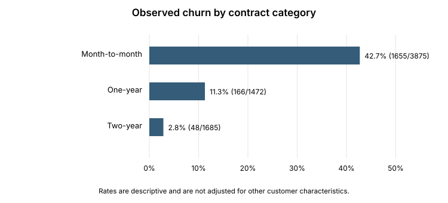
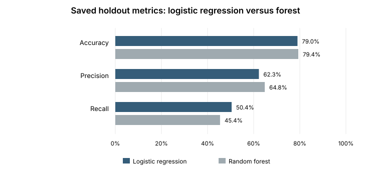

# Predicting Telecommunications Customer Churn with Classification Models

**A comparison of logistic regression, random forests and missed-customer risk**

**Amogelang R. Pelo**

## Abstract

I evaluate a machine-learning project that compares logistic regression and random forest classifiers for identifying telecommunications customers recorded as having left a service. The repository includes a customer dataset with **7,043 rows**, of which **11 have blank `TotalCharges` values**. The notebook converts this field to numeric, removes incomplete observations and one-hot encodes categorical attributes, producing **7,032 complete rows**. In the cleaned sample, **1,869 customers** have `Churn = Yes`, an observed churn share of **26.58%**. I distinguish the source notebook's methods from its preserved output and additional descriptive calculations.

The preserved original notebook reports random forest accuracy of approximately **79.35%**, precision of **64.80%** and recall of **45.41%** on a 1,758-record test set. For logistic regression, the saved precision is approximately **62.26%** and recall **50.44%**. However, the notebook's reported logistic accuracy of 79.01% is inconsistent with the accuracy implied by its saved confusion matrix, **79.12%**, and a convergence warning is present. These inconsistencies should be resolved before presenting a definitive head-to-head result. The forest misses **250 of 458** observed churners in the test set, compared with **227 missed churners** for logistic regression. I conclude that overall accuracy alone is insufficient for retention-oriented model selection; recall, false-negative costs, calibration and reproducible preprocessing are central to assessing practical usefulness.

**Keywords:** telecommunications; customer churn; logistic regression; random forest; precision; recall; class imbalance; model validation.

## 1. Introduction

Customer churn refers to the discontinuation of a business relationship or service. In a subscription business, a model that estimates which customers may leave can help analysts investigate retention risks. Whether that model creates value depends on more than achieving a high average accuracy: it must identify relevant customers with sufficiently low false-negative and false-positive costs for the intended intervention.

The project examined here treats churn as a binary classification task. It uses account, service, billing and demographic fields to construct predictive features. It then trains a logistic regression model and a random forest, evaluates both on a held-out subset and discusses the importance of customers who actually leave but are predicted to stay (Pelo, n.d.-a).

My research question is: **How do the two classifiers differ in their treatment of churn and non-churn outcomes, and what limitations affect the credibility of the saved model comparison?** I answer through source-code review, direct examination of the accompanying CSV and examination of preserved notebook metrics.

I do not treat the dataset as a live customer base of any identified telecom operator. The precise original extraction process, observation period and licensing provenance are not established by the project files. The results are therefore properties of this educational dataset and its documented model execution.

## 2. Conceptual framework

### 2.1 Binary classification and logistic regression

A churn model assigns a class label or probability to each customer record. The source labels `Churn = Yes` as the positive case and `Churn = No` as the negative case. Logistic regression models the positive-class probability through a logistic link applied to a linear combination of features (James *et al.*, 2021).

A logistic model offers a relatively interpretable baseline and can produce useful probabilities when correctly specified and calibrated. However, its coefficients are conditional associations rather than causal explanations of why customers leave. A coefficient may also be unstable in the presence of correlated services or billing attributes.

The notebook sets `max_iter=1000` when fitting logistic regression. The preserved original output includes a convergence warning indicating that the optimiser reached the iteration limit. Such a warning warrants investigation of feature scaling, solver choice, regularisation and model convergence before interpreting scores as a fully settled solution.

### 2.2 Random forest classification

Random forests combine predictions from an ensemble of decision trees grown on bootstrap samples and random feature subsets. They can represent nonlinear effects and feature interactions without specifying a global linear decision boundary (Breiman, 2001).

The source forest uses **2,000 estimators**, `oob_score=True`, `max_features="sqrt"`, `max_leaf_nodes=50`, bootstrapping and `random_state=42`. Limiting leaf nodes constrains tree complexity; using many trees reduces some ensemble variability but does not guarantee superior generalisation or a higher recall for the churn class.

The notebook also reports out-of-bag (OOB) error. An OOB estimate comes from predictions on training records excluded from individual trees' bootstrap samples; it is a useful diagnostic, though not a replacement for a carefully maintained final test set (Breiman, 2001).

### 2.3 Confusion matrix and class-specific errors

For a binary outcome, the confusion matrix separates correctly identified non-churners (true negatives), correctly identified churners (true positives), false positive churn alerts and false negative missed churners. **Precision** is true positives divided by all predicted positives, while **recall** is true positives divided by all actual positives.

The distinction is commercially significant. A false negative is an observed churner the model predicts will stay, potentially removing that customer from a retention intervention. A false positive prompts attention toward a customer who would not have churned in the recorded outcome. The costs of these errors vary by business context and cannot be inferred from the confusion matrix alone.

Accuracy can appear high when one class is more common, even if detection of the minority class is weak. Precision, recall, balanced accuracy and threshold-dependent performance should accompany it in a retention analysis (Saito and Rehmsmeier, 2015).

### 2.4 Preprocessing and data leakage

For a trustworthy model comparison, data-dependent preprocessing should generally be learned from the training partition and applied unchanged to evaluation records. Scikit-learn's guidance treats fitting transformations on test records as a potential source of leakage and encourages pipelines that preserve training/test separation (scikit-learn developers, n.d.-a).

The portfolio notebook computes a `MinMaxScaler` transformation but subsequently builds `X_train` and `X_test` from the *unscaled* dummy-coded dataframe. Thus the fitted models do not use `scaled_df` in that version. The presence of a scaling cell is not evidence that the models were trained on scaled predictors. This is a source-visible distinction that affects interpretation of the convergence warning.

## 3. Data and methods

### 3.1 Dataset and cleaning

The repository CSV contains **7,043 customers and 21 columns**, including customer ID, tenure, contract type, service subscriptions, billing fields and churn outcome. I inspected categorical counts and blank records directly from the file. The field `TotalCharges` contains **11 blank strings**. The code converts them to missing numeric values and removes those rows, leaving **7,032 records** (Pelo, n.d.-a; Pelo, n.d.-c).

| Property | Verified result |
|:--|--:|
| Original rows | 7,043 |
| Original columns | 21 |
| Missing `TotalCharges` entries | 11 |
| Complete records after removal | 7,032 |
| Recorded churners after cleaning | 1,869 |
| Recorded non-churners after cleaning | 5,163 |
| Observed churn proportion | 26.58% |
| Median tenure after cleaning | 29 months |

The notebook removes `customerID`, which is appropriate for avoiding direct use of an arbitrary record identifier as a predictor. It recodes the target and uses pandas dummy variables for categories such as contract type, internet service and payment method.

### 3.2 The current implementation and saved versions

The current portfolio notebook constructs dummy variables, creates a `scaled_df` copy and then selects the outcome from `telecom_cust_dummies`, not from the scaled copy. It trains logistic regression and a random forest after a 75/25 split with `random_state=42` (Pelo, n.d.-a).

The repository also contains two preserved earlier notebook versions. The second original version retains performance outputs and a logistic convergence warning. The first original version uses a somewhat different target and preprocessing representation. Because their saved values are not identical, I use the **second original notebook** as the main reference for the metric table and describe its inconsistencies rather than merging outputs from both versions as if they came from one execution (Pelo, n.d.-b).

### 3.3 Additional descriptive calculations

I independently checked churn counts and contract-type groups. These descriptive values are calculated directly from the cleaned CSV and are not claimed as outputs of new model fits. The performance values and confusion matrices in the following sections are taken from the original saved notebook and have not been independently retrained.

A train/test split of 7,032 rows with a 25% test fraction corresponds to **5,274 training observations and 1,758 test observations**. The saved confusion matrices show **458 actual churners and 1,300 actual non-churners** in the particular test partition.

## 4. Descriptive findings and potential retention signals

### 4.1 Class balance

The cleaned dataset has **1,869 recorded churners** and **5,163 recorded non-churners**, meaning approximately one-quarter of customers belong to the positive class. A model that always predicted that no one would churn could appear substantially accurate while identifying no at-risk customers.

For the preserved test partition, a constant non-churn prediction would classify 1,300 of 1,758 records correctly, yielding an accuracy of approximately **73.95%**, but a churn-class recall of zero. This illustrates why accuracy alone is not an adequate retention model criterion.

### 4.2 Contract categories

The cleaned records show materially different raw churn shares across contract categories:

| Contract type | Records | Recorded churners | Observed churn rate |
|:--|--:|--:|--:|
| Month-to-month | 3,875 | 1,655 | 42.71% |
| One year | 1,472 | 166 | 11.28% |
| Two year | 1,685 | 48 | 2.85% |

<figure class="chart wide"><figcaption>Figure 1. Descriptive churn rate by contract category in the 7,032 cleaned source records. Differences are unadjusted and do not establish a causal effect of contract duration.</figcaption></figure>

This is a strong descriptive association in the supplied data. It should not be interpreted as proof that switching a customer to a longer contract would independently prevent churn. Customers who select longer contracts may differ in tenure, services, price, expectations and other characteristics. A causal policy evaluation would require a separate design.

### 4.3 Tenure and billing features

The source uses customer tenure, monthly charges, total charges and service variables. The current notebook contains exploratory plots of tenure distribution, monthly versus total charges and tenure by churn. Such variables can provide useful predictive information, but the analysis does not isolate the causal mechanisms behind observed relationships.

The conversion of `TotalCharges` to numeric values is an important cleaning step. However, removing all records with blank values changes the analysed population slightly. Reporting the deletion count helps preserve reproducibility and avoids implying that the original dataset contained no incomplete records.

## 5. Results: model comparison

### 5.1 Preserved test metrics

The second original notebook records the following results for the test set:

| Metric | Logistic regression | Random forest |
|:--|--:|--:|
| Printed accuracy | 79.01% | 79.35% |
| Precision for churn | 62.26% | 64.80% |
| Recall for churn | 50.44% | 45.41% |
| OOB error | Not applicable | 19.26% |

<figure class="chart wide"><figcaption>Figure 2. Metrics transcribed from the second original notebook's saved output. Logistic accuracy is inconsistent with its saved confusion matrix and requires a reproducible rerun.</figcaption></figure>

The forest has higher printed accuracy and precision but lower recall for churners. For a business specifically seeking to identify customers who may leave, **the forest's lower recall may outweigh its small accuracy advantage**, depending on intervention costs and the available budget.

### 5.2 Saved confusion matrices

The second original notebook contains the following confusion matrices, where rows are actual labels and columns are predicted labels in the order non-churn (0), churn (1):

| Logistic regression | Predicted stay | Predicted churn |
|:--|--:|--:|
| Actual stay | 1,160 | 140 |
| Actual churn | 227 | 231 |

| Random forest | Predicted stay | Predicted churn |
|:--|--:|--:|
| Actual stay | 1,187 | 113 |
| Actual churn | 250 | 208 |

The forest has **23 additional false negatives** relative to logistic regression in these matrices, although it has **27 fewer false positives**. Thus the models exhibit a trade-off between identifying churners and avoiding unnecessary churn alerts. Neither model dominates on every metric.

### 5.3 A numerical inconsistency requiring correction

The preserved logistic confusion matrix implies accuracy **(1,160 + 231)/1,758 = 79.12%**. Yet the same original notebook includes a printed logistic accuracy of **79.01%**. Those cannot both describe the same fixed predictions and labels. The disparity is small but academically material: it indicates an inconsistent execution state, stale output cell or another unrecorded difference.

The forest's confusion matrix implies **(1,187 + 208)/1,758 = 79.35%**, consistent with its printed result. The current portfolio notebook does not preserve model outputs. I therefore do **not** claim that it independently verifies the earlier figures or that the printed logistic score has been reconciled.

### 5.4 Convergence and scaling limitations

The preserved original version shows a `ConvergenceWarning` for logistic regression after 1,000 iterations. The portfolio version calculates min–max scaled features but leaves those features unused in the actual model split. This is a meaningful implementation issue: the notebook discusses scaling as part of feature preparation, yet the fitted classifier's actual input remains the unscaled dataframe.

A better follow-on experiment would compare properly scaled logistic regression with the forest, using a `Pipeline` that fits transformations only on the training portion. The convergence status should be checked and recorded before performance comparisons are treated as final.

### 5.5 Out-of-bag error

The forest prints OOB error **0.192643...**, or approximately 19.26%. That value is calculated as `1 - rf_model.oob_score_`. It provides a model-specific diagnostic based on bootstrap sampling within the training process and is not identical to the held-out test error.

It should not be mixed with confusion-matrix metrics as though it came from the same records. Comparisons between OOB and held-out performance require careful attention to sample source and evaluation definition (Breiman, 2001).

## 6. Decision implications and methodological improvements

### 6.1 Accuracy versus retention usefulness

In a retention setting, a missed churner may represent an opportunity for intervention that was not offered. However, contacting every predicted churner has a cost and may annoy customers who were unlikely to leave. Model selection should therefore use an explicit decision threshold and an economic objective rather than automatically favour the highest accuracy.

I would measure recall at different precision levels, evaluate the precision–recall curve and consider top-k targeting where only a limited number of customers can be contacted. Precision–recall analysis is particularly relevant when positive cases are less common than negatives (Saito and Rehmsmeier, 2015).

### 6.2 Reproducible model pipeline

The portfolio notebook should be revised so that its evaluated feature matrix is unambiguous. I would first separate predictors and target, then split the rows, fit preprocessing only on training data, and apply the fitted transformations to the test set. The same protocol should be used across both models, with any model-specific choices documented.

If the original notebook's results change after these corrections, the new scores should be reported as **new validation results**, not silently substituted for historical saved outputs. Clear versioning is central to a credible research portfolio.

### 6.3 Calibration and deployment limits

A classifier's probability estimates should be checked for calibration before being used to prioritise costly interventions. Good classification accuracy does not ensure that a predicted churn probability of 0.7 corresponds to a 70% observed churn frequency in similarly scored groups.

The dataset is not documented as a current, operational customer stream. Before any real use, a company would need consent and data-governance review, clarity about observation periods, drift monitoring and an evaluation of whether predictions differ systematically between customer groups.

### 6.4 Suggested validation plan

| Next-stage analysis | Purpose |
|:--|:--|
| Refit logistic regression with training-only scaling | Resolve convergence and compare fairly |
| Recompute scores and matrices in one execution | Eliminate inconsistent saved results |
| Assess precision–recall at alternative thresholds | Match intervention capacity and error costs |
| Examine calibration | Interpret probabilities responsibly |
| Compare class-weight and resampling approaches | Investigate missed churners |
| Evaluate across time if dated data become available | Test stability under changing customer behaviour |

These are proposed analyses, not experiments claimed as completed by the current project. I do not assert that any one of these changes will improve performance without test evidence.

## 7. Reproducibility and conclusion

### 7.1 Evidence and source boundaries

This research combines independently computed descriptive statistics from the CSV with preserved model outputs from the second original notebook. The distinction matters because the portfolio notebook contains implementation changes and no retained numerical execution results. Future work should pin package versions, preserve a stable test set and save model predictions or an evaluation table so that all reported metrics can be checked for internal consistency.

### 7.2 Conclusion

I find that the source project illustrates the mechanics of customer-churn classification and the business relevance of distinguishing missed leavers from unnecessary alerts. In the cleaned dataset, churn occurs in approximately **26.58%** of records, with a particularly high unadjusted share among month-to-month contracts. The preserved models achieve roughly 79% test accuracy but miss substantial numbers of actual churners.

The principal result is a **trade-off**, not a clear universal winner. The random forest yields slightly higher saved precision and printed accuracy, while logistic regression identifies a larger share of observed churners. The unresolved logistic accuracy discrepancy and convergence warning also mean the numerical comparison should be treated as provisional until a reproducible run resolves them.

I would retain this work as a strong educational classification case study, strengthened by transparent error analysis and a corrected preprocessing pipeline. Its research value is greatest when the decision costs and methodological limitations are made explicit rather than reduced to a single headline accuracy number.

## References

Breiman, L. (2001) ‘Random forests’, *Machine Learning*, 45, pp. 5–32.

James, G., Witten, D., Hastie, T. and Tibshirani, R. (2021) *An Introduction to Statistical Learning: With Applications in R*. 2nd edn. New York: Springer.

Pelo, A.R. (n.d.-a) *Telecommunications customer churn: portfolio notebook*. GitHub portfolio. Available at: https://github.com/amopelo-southafrica/AI-Engineering-and-Research/blob/main/Machine-Learning/predicting-which-customers-leave/customer_churn_prediction.ipynb.

Pelo, A.R. (n.d.-b) *Telecommunications customer churn: preserved original notebook, version 2*. GitHub portfolio. Available at: https://github.com/amopelo-southafrica/AI-Engineering-and-Research/blob/main/Machine-Learning/predicting-which-customers-leave/telco_churn_original_v2.ipynb.

Pelo, A.R. (n.d.-c) *Telco-Customer-Churn.csv: project dataset*. GitHub portfolio. Available at: https://github.com/amopelo-southafrica/AI-Engineering-and-Research/blob/main/Machine-Learning/predicting-which-customers-leave/Telco-Customer-Churn.csv.

Saito, T. and Rehmsmeier, M. (2015) ‘The precision-recall plot is more informative than the ROC plot when evaluating binary classifiers on imbalanced datasets’, *PLOS ONE*, 10(3), e0118432.

scikit-learn developers (n.d.-a) *Common pitfalls and recommended practices*. scikit-learn user guide. Available at: https://scikit-learn.org/stable/common_pitfalls.html.
