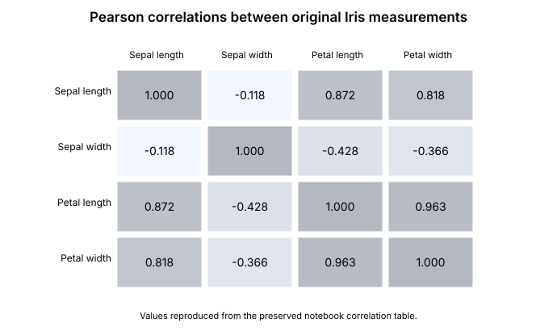
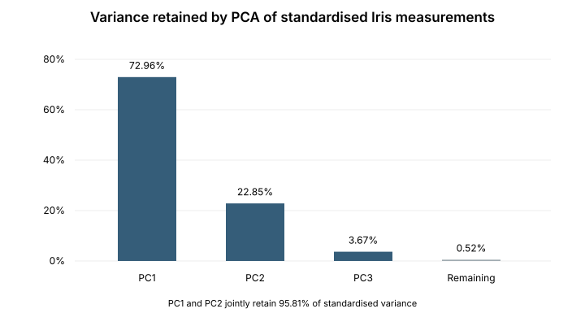

# Principal Component Analysis of Iris Flower Measurements

**A study of feature correlation, variance retention and exploratory clustering**

**Amogelang R. Pelo**

## Abstract

I examine an unsupervised-learning project that performs principal component analysis (PCA) on the Iris flower dataset and explores K-means and hierarchical clustering in the transformed feature space. The original notebook loads **150 observations** and four numeric features through scikit-learn's `load_iris`, standardises those variables and fits a PCA with three components. The preserved output reports explained-variance ratios of **72.9624%**, **22.8508%** and **3.6689%** for PC1, PC2 and PC3 respectively. The first two components together account for approximately **95.81%** of the total variance of the standardised features.

The source notebook also reports a strong correlation of approximately **0.963** between petal length and petal width, illustrating substantial redundancy among original measurements. I review how PCA replaces correlated measurements with orthogonal axes, why standardisation is relevant and what information is lost through dimensionality reduction. The notebook then runs K-means with three clusters and Ward hierarchical clustering, but does not preserve numerical cluster membership or external agreement scores. I therefore do not claim that the discovered clusters exactly reproduce botanical species. I conclude that the project is a coherent example of exploratory dimensionality reduction, with the strongest reproducible result being its explained-variance structure rather than an unverified classification outcome.

**Keywords:** Iris dataset; principal component analysis; dimensionality reduction; feature correlation; K-means; hierarchical clustering; exploratory learning.

## 1. Introduction

Many measurements describe overlapping aspects of the same underlying phenomenon. In botanical data, length and width variables may move together because they reflect related morphological characteristics. Analysing such correlated variables directly is possible, but reducing them to a smaller set of informative dimensions can simplify plots and reveal broad geometric structure. Principal component analysis is one of the best-established methods for achieving this reduction (Jolliffe, 2002).

The Iris dataset is a familiar statistical benchmark containing measurements of flowers belonging to three species. It is useful because each observation has four interpretable measurements, and the groups are neither identical nor wholly indistinguishable (Fisher, 1936). The project studied here intentionally performs **unsupervised** analysis: it uses the numerical features to calculate components and clusters, rather than training a classifier on the species labels.

The source notebook loads data through `sklearn.datasets.load_iris()`, calculates correlations, standardises features, fits PCA, plots component scores, creates a K-means partition and constructs a Ward-linkage dendrogram (Pelo, n.d.-a). Its written interpretation suggests that petal variables are correlated and that lower-dimensional clustering can recover broad groupings.

My research question is: **How much information about the standardised Iris measurements is retained in a reduced PCA representation, and what limits the interpretation of clusters formed from those components?** I examine the source code and saved numerical output and relate the results to the theory of PCA and clustering. I distinguish the actual notebook findings from supplementary presentation and proposed validation tests.

## 2. Literature and conceptual framework

### 2.1 Feature correlation and redundancy

Correlation measures the extent to which two variables vary together under a specified relationship, often the linear Pearson association. When two columns are strongly correlated, they may contain partly redundant information. Petal length and petal width in the Iris dataset provide a familiar example: larger petals tend to have related dimensions.

Redundancy is not inherently a problem. A well-specified analysis can use correlated predictors. However, plotting every dimension becomes difficult as the number of features grows, and some modelling techniques are sensitive to the relative scale and covariance of variables. PCA provides a systematic method of summarising shared linear variation (Jolliffe, 2002).

An important distinction is that PCA is **not** a method for selecting the original feature with the highest predictive power. It constructs new linear combinations of features that maximise variance, without using species labels or a supervised objective.

### 2.2 Standardisation before PCA

The notebook uses `StandardScaler` to transform each original feature by subtracting its sample mean and dividing by its standard deviation. This is a reasonable choice when the aim is to give the four measured variables comparable variance scales before computing principal components (scikit-learn developers, n.d.-a).

Without scaling, variables with larger numerical variation can dominate a covariance-based PCA even when their absolute units are not substantively more important. After scaling, PCA operates on a representation closely related to the original variables' correlation structure rather than their raw physical variances.

Standardisation should not be interpreted as eliminating correlations or making the data normally distributed. Correlated features remain correlated after separate positive affine rescaling. It is the subsequent PCA rotation that creates new components with zero sample covariance.

### 2.3 PCA and explained variance

PCA finds orthogonal directions of maximal variance. The first principal component captures the largest share of variance, the second captures the greatest remaining share subject to being orthogonal to the first, and later components repeat this process. The explained-variance ratio is the variance associated with a component divided by total variance (Jolliffe, 2002).

Because the components are orthogonal by construction, the transformed scores have zero sample covariance up to numerical precision. This is distinct from independence: uncorrelated variables need not be statistically independent in a non-Gaussian distribution.

A high cumulative explained-variance ratio means a chosen number of components preserves much of the original standardised variation. It does **not** establish a comparable percentage of classification accuracy, biological explanation or reconstruction quality for every individual feature.

### 2.4 Clustering transformed observations

K-means assigns points to a specified number of groups to reduce within-cluster squared distances to centroids (MacQueen, 1967). Hierarchical Ward clustering produces nested groups by joining points in a way that controls increases in within-cluster variation (Ward, 1963). Both are sensitive to the chosen feature representation.

The project uses three K-means groups, matching the number of known Iris species. However, supplying `n_clusters=3` does not make the clusters correspond automatically to species. The algorithm has no access to those labels during fitting, and its cluster numbers are arbitrary.

An external comparison with species would require an agreement statistic, such as adjusted Rand index, or a contingency table between predicted clusters and known labels. Neither is retained in the supplied notebook.

## 3. Dataset, code and research design

### 3.1 Data source

The notebook calls `load_iris()` from scikit-learn and creates a pandas dataframe with four columns: sepal length, sepal width, petal length and petal width, each measured in centimetres. The preserved output confirms **150 complete rows** and no missing numeric values in those four columns (Pelo, n.d.-b; scikit-learn developers, n.d.-b).

The project folder also contains a separate `Iris.csv` file with species labels and identifiers. The PCA notebook, however, does **not read that CSV**; it loads the library dataset directly. For accurate reproduction, the notebook's source of features is therefore the scikit-learn loader, not the adjacent CSV. The two resources should not be silently substituted for one another without checking that the exact records and numeric values match.

### 3.2 Source workflow

The code examines dataset structure with `info()` and `describe()`, calculates feature correlations, and uses seaborn to display a heatmap. It standardises the four columns and applies `PCA(n_components=3)`. The transformed scores are stored in `pca_df`, and the explained-variance ratios are printed.

The notebook plots PC1 against PC2 and draws arrows based on the fitted component coefficients. It then fits `KMeans(n_clusters=3, random_state=42)` to all three PCA scores and displays the first two coordinates with cluster colours. Finally, it applies Ward hierarchical linkage to the same three-component score matrix.

The distinction between **clustering in three dimensions** and **plotting only two dimensions** is significant. A point's K-means assignment may depend on its PC3 coordinate even if two points appear close together in the PC1–PC2 plot. It would be incorrect to say the model clusters solely on two dimensions, despite the two-dimensional visualisation.

### 3.3 Evidence and reproduction policy

I used the preserved output of the original notebook to report correlations and explained-variance ratios. I did not infer a new K-means score, silhouette coefficient, cluster membership or biological agreement statistic. The figures created for this paper reproduce recorded numerical information; they are not presented as newly fitted models.

The original notebook does not use a train/test split because it is an exploratory dimensionality-reduction exercise rather than a predictive classifier. If PCA were later used within supervised machine learning, its fit should be restricted to training data to avoid leakage into a final evaluation set.

## 4. Empirical findings

### 4.1 Correlations in the original features

The original notebook's saved correlation table contains several substantial associations:

| Feature pair | Pearson correlation |
|:--|--:|
| Petal length and petal width | +0.963 |
| Sepal length and petal length | +0.872 |
| Sepal length and petal width | +0.818 |
| Sepal width and petal length | −0.428 |
| Sepal width and petal width | −0.366 |
| Sepal length and sepal width | −0.118 |

<figure class="chart wide"><figcaption>Figure 1. Correlations transcribed from the preserved original notebook output. The strong positive petal correlation indicates shared variation in the measurements.</figcaption></figure>

The petal variables are very strongly positively correlated, while sepal width has negative relationships with several other features. This provides an empirical motivation for PCA: correlated coordinates can be rotated into new axes that capture most of their joint variation.

The correlation table alone cannot establish causation or identify which variables are necessary to distinguish species. The notebook's PCA step is unsupervised and does not use labels to optimise separation.

### 4.2 Explained variance by component

The original notebook prints `[0.72962445 0.22850762 0.03668922]` for its three fitted components. Expressed as percentages, these correspond to the following:

| Component | Variance explained | Cumulative variance explained |
|:--|--:|--:|
| PC1 | 72.9624% | 72.9624% |
| PC2 | 22.8508% | 95.8132% |
| PC3 | 3.6689% | 99.4821% |
| Omitted fourth direction | ~0.5179% | 100.0000% |

The fourth share is calculated as the residual to 100% after the three displayed ratios; it is not printed in the notebook because the fitted PCA requests only three components.

<figure class="chart wide"><figcaption>Figure 2. Explained variance derived from the notebook's saved PCA output. PC1 and PC2 retain approximately 95.81% of standardised total variance, while PC3 adds 3.67%.</figcaption></figure>

The first two components contain most of the dataset's standardised variation. Retaining three components brings total retained variance to approximately 99.48%. Thus the chosen three-dimensional representation preserves nearly all total variance while reducing the feature count from four to three.

### 4.3 Correlations after PCA

The notebook visualises the correlation matrix of the transformed PC1, PC2 and PC3 scores and notes that the transformed features have low correlations. Under standard PCA, the component scores are orthogonal, so the sample correlations between distinct components should be close to zero up to floating-point precision.

This is a mathematical property of the fitted transformation, not an independently demonstrated biological independence of petal and sepal growth. The components are constructed from the original features and continue to reflect the same dataset.

### 4.4 Biplot interpretation

The PC1–PC2 visualisation places flowers according to their first two component scores and draws vectors representing original feature directions. Longer vectors can indicate stronger projection onto the displayed plane under the selected plotting scale, while similar directions suggest related feature contributions.

A biplot combines point positions and variable directions in one image, but its appearance depends on scaling conventions and sign orientation. The source multiplies component coefficients by two for plotting, which is a visual scaling choice rather than an estimated physical effect. The component axes should not be labelled with specific biological mechanisms without inspecting the numerical loadings and their uncertainty.

### 4.5 K-means and hierarchical output

The notebook fits K-means with `n_clusters=3` and produces a cluster-coloured plot. It also computes Ward linkage and displays a dendrogram. These steps demonstrate the process of grouping PCA-transformed observations through two different unsupervised methods.

The source commentary states that the clusters roughly match three botanical species. That statement is plausible as an exploratory interpretation, but it is **not backed in the notebook by a quantitative comparison of cluster labels with species labels**. No contingency table, adjusted Rand index or silhouette analysis is retained. A rigorous paper must therefore describe the procedures as performed while reserving an externally validated agreement claim for a separate calculation.

## 5. Critical discussion

### 5.1 What the variance results establish

The primary reproducible result is the dimensionality reduction itself. Two PCA axes retain approximately 95.81% of the measured standardised variation. This makes a two-dimensional plot attractive and provides a mathematical basis for thinking that much of the feature structure can be displayed without four separate axes.

It would nevertheless be incorrect to say that the model is 95.81% “accurate” or that 95.81% of biological differences between species are explained. PCA is not trained to predict species, and it does not distinguish variance caused by botanical structure from variance caused by measurement noise.

### 5.2 PCA for clustering versus PCA for presentation

The source fits K-means and Ward linkage on three PCA dimensions but displays results on only two. That choice is defensible, yet it creates a gap between the distance calculation and the displayed geometry. Apparent overlap in a scatterplot need not imply that observations are close in the full three-dimensional clustering space.

A useful extension would compare K-means results on two versus three PCs, as well as on the original four standardised features. This would test whether the retained PC3 variation materially changes assignment. No such sensitivity comparison is reported in the current notebook.

### 5.3 The number of clusters is a research decision

Choosing three clusters because the dataset contains three known species is a convenient instructional choice. In a genuinely exploratory study, the appropriate number of clusters would be unknown. Using label knowledge to choose `k` is not equivalent to a fully unsupervised determination of cluster count.

I would evaluate several values of `k`, calculate a silhouette score and inspect cluster stability across seeds or initialisations. I would then separately compare assignments with known species labels. This would distinguish **internal cluster structure** from **external botanical agreement** (Hastie, Tibshirani and Friedman, 2009).

### 5.4 Generalisability and dataset variants

The Iris benchmark is small and well studied. It is an effective teaching resource but not representative of the challenges of high-dimensional, noisy field measurements. Differences between the scikit-learn loader and various CSV copies can also affect exact outputs if records or corrections differ.

I would preserve the dependency versions, the source-loading method and a checksum or data-description reference so that future readers can reproduce the same feature matrix. Adding source provenance is particularly valuable when a repository contains both a library-loaded dataset and an unused adjacent CSV.

## 6. Recommended validation and reproducibility

### 6.1 Minimum additional checks

A more complete version of the project would save the component-loading matrix, inspect reconstruction error, export K-means memberships and compare alternative numbers of clusters. These outputs would let a reader test whether the proposed group descriptions follow from measurable state or feature differences rather than visual impressions.

| Proposed check | Research purpose |
|:--|:--|
| Save `pca.components_` | Interpret original feature contributions |
| Compare 2 versus 3 PCs | Assess sensitivity to excluded dimensions |
| Export `kmeans_labels` with sample IDs | Verify cluster membership |
| Compute silhouette across candidate `k` | Evaluate internal separation |
| Compare clusters with species labels | Test external agreement |
| Use repeated initialisations | Evaluate assignment stability |
| Record software and data version | Improve reproducibility |

These are proposed further analyses. I do not present their results as already established by the source notebook.

### 6.2 Reproducing the PCA result

The original transformation is implemented by loading the Iris data and standardising all four features before fitting PCA:

```python
from sklearn.datasets import load_iris
from sklearn.preprocessing import StandardScaler
from sklearn.decomposition import PCA

iris = load_iris()
X_scaled = StandardScaler().fit_transform(iris.data)
pca = PCA(n_components=3)
scores = pca.fit_transform(X_scaled)
print(pca.explained_variance_ratio_)
```

This sequence reproduces the essential PCA computation in the source, subject to the installed package versions. A subsequent clustering analysis should specify whether it uses two or three component scores and retain the cluster-assignment results.

### 6.3 Limitations

This study is a source-based review of an educational notebook. The numerical explained-variance and correlation results are taken from its preserved execution. The current report does not independently retrain PCA or clustering models, estimate uncertainty or validate cluster agreement. Claims about how well clusters correspond to species therefore remain qualitative and explicitly unverified.

## 7. Conclusion

I find that the project provides a clear demonstration of PCA as a tool for summarising correlated measurements. The preserved notebook shows that the first two principal components explain approximately **95.81%** of the total standardised variance, and the first three explain approximately **99.48%**. The large petal length–width correlation provides context for why such compression is possible.

The clustering steps extend the exercise into unsupervised grouping, but their substantive interpretation is less firmly documented. The use of three predefined clusters and the absence of an external agreement table prevent a verified claim that the algorithm recovered the three species.

I would present the work as evidence of practical skill in standardisation, dimensionality reduction, visualisation and introductory clustering, with a clear distinction between the established PCA results and proposed cluster validation. That distinction strengthens the credibility of the research rather than diminishing the project.

## References

Fisher, R.A. (1936) ‘The use of multiple measurements in taxonomic problems’, *Annals of Eugenics*, 7(2), pp. 179–188.

Hastie, T., Tibshirani, R. and Friedman, J. (2009) *The Elements of Statistical Learning: Data Mining, Inference, and Prediction*. 2nd edn. New York: Springer.

Jolliffe, I.T. (2002) *Principal Component Analysis*. 2nd edn. New York: Springer.

MacQueen, J. (1967) ‘Some methods for classification and analysis of multivariate observations’, *Proceedings of the Fifth Berkeley Symposium on Mathematical Statistics and Probability*, 1, pp. 281–297.

Pelo, A.R. (n.d.-a) *Iris principal component analysis: portfolio notebook*. GitHub portfolio. Available at: https://github.com/amopelo-southafrica/AI-Engineering-and-Research/blob/main/Machine-Learning/visualising-data-with-pca/iris-principal-component-analysis.ipynb.

Pelo, A.R. (n.d.-b) *Iris PCA: original notebook*. GitHub portfolio. Available at: https://github.com/amopelo-southafrica/AI-Engineering-and-Research/blob/main/Machine-Learning/visualising-data-with-pca/iris_pca_original.ipynb.

scikit-learn developers (n.d.-a) *StandardScaler*. scikit-learn documentation. Available at: https://scikit-learn.org/stable/modules/generated/sklearn.preprocessing.StandardScaler.html.

scikit-learn developers (n.d.-b) *The Iris dataset*. scikit-learn user guide. Available at: https://scikit-learn.org/stable/datasets/toy_dataset.html.

Ward, J.H. (1963) ‘Hierarchical grouping to optimize an objective function’, *Journal of the American Statistical Association*, 58(301), pp. 236–244.
